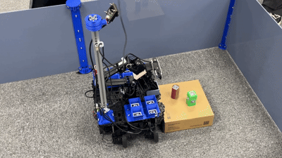
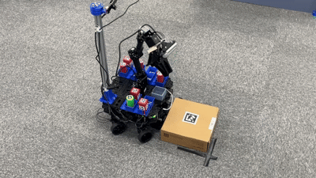
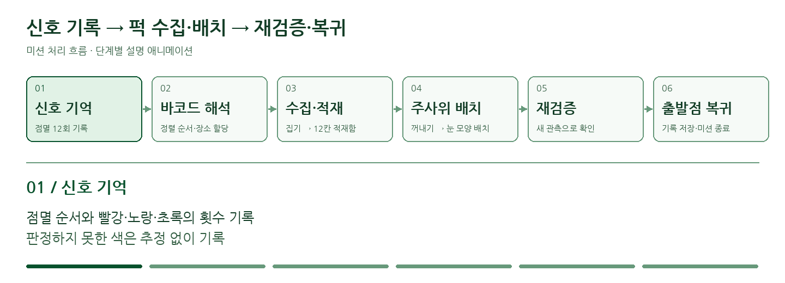
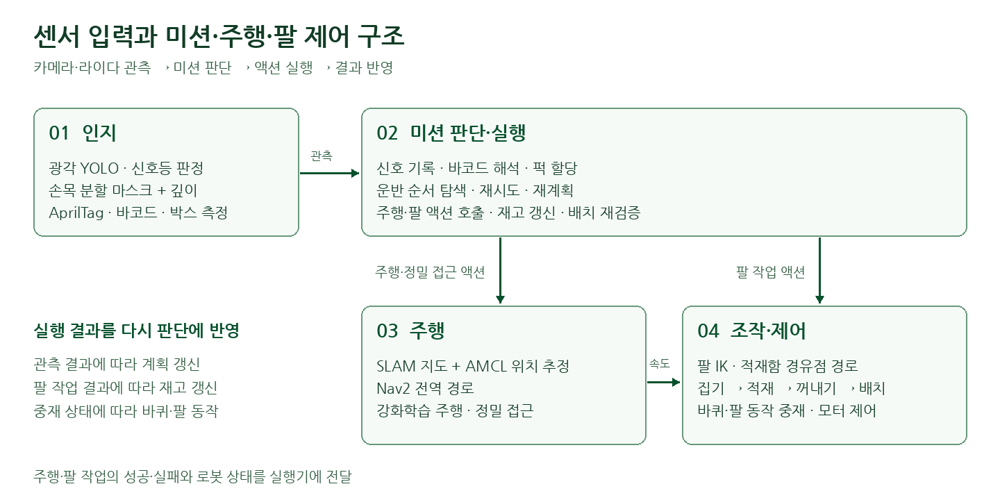
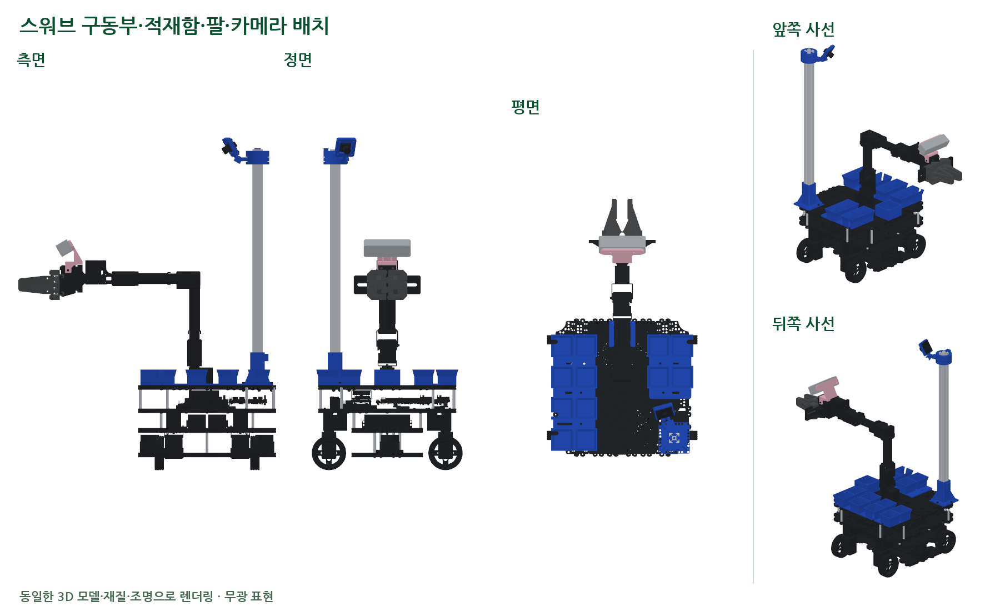
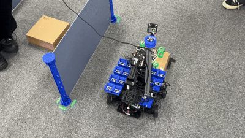
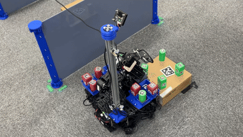
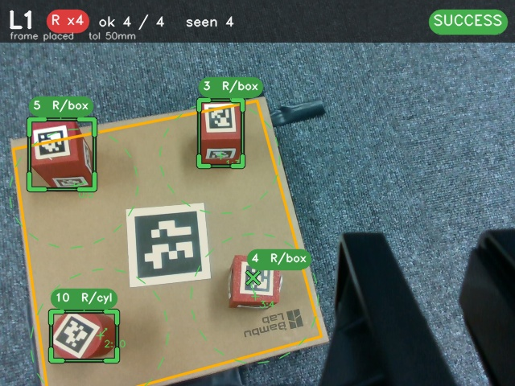
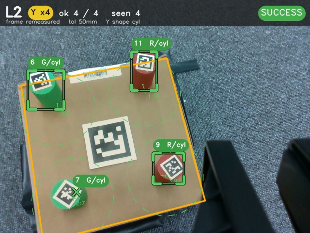
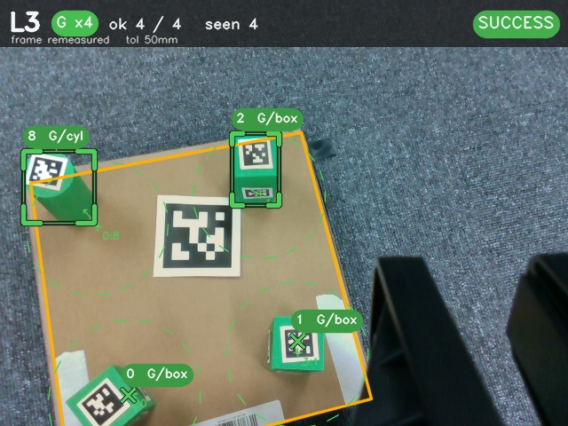

<h1 align="center">KANT Project 2 : 주사위 기억 자율 주행 로봇</h1>

<p align="center">
<b>팀 닌자터틀</b><br>
</p>

<p align="center"><sub>ROS 2 Lyrical · Jetson Orin Nano · YOLO26 · Isaac Sim</sub></p>

<p align="center">

</p>

<p>


</p>

<sub>왼쪽: 집기·적재 21초 · 오른쪽: 꺼내기·배치 26초</sub>

## 미션 처리 흐름



<sub>단계별 설명용 애니메이션으로 실제 수행 시간과 무관함. [정적 이미지](docs/assets/readme/mission-flow.png)</sub>

## 시스템 구조



### 인지

- 광각 카메라로 신호등과 바코드 검출
- 손목 카메라로 퍽 탐지, 깊이 계산, AprilTag 인식을 수행해 퍽의 색·모양·위치·ID 판독

### 계획

- 신호와 바코드로 배치를 결정하고 Dijkstra로 운반 순서 계산
- 실행 결과에 따라 재고를 갱신하고, 실패 시 재시도 및 재계획

### 주행

- SLAM 지도와 AMCL로 위치 추정
- Nav2 전역 경로를 따르는 강화학습 주행과 라이다 기반 정밀 접근으로 박스 앞 정차

### 조작

- IK와 적재함 경유점 경로로 집기·적재·꺼내기·배치 수행
- 퍽을 적재한 뒤 이동하며, 제어 중재에 따라 바퀴와 팔 동작

[노드·토픽·좌표계 상세](report/docs/architecture.md)

## 로봇 설계

<p align="center">

</p>

<sub>동일한 3D 모델·재질·조명으로 렌더링한 측면·정면·평면과 앞·뒤 사선뷰. 부품 표면은 무광으로 표현. <a href="mechanical/robot">STEP·부품 도면·설계 기록</a></sub>

## Swerve Drive

- 네 바퀴의 **연속 조향**과 독립 구동으로 전후·좌우 이동과 회전을 조합
- Nav2가 생성한 전역 경로를 따라 **강화학습 정책으로 지역 주행과 정밀 접근** 수행
- 라이다로 박스 위치를 측정해 정차 목표를 보정하고, 배치대 앞까지 접근

<p>


</p>

<sub>왼쪽: Swerve Drive 주행 29초 · 오른쪽: 배치대 앞 정밀 접근 26초</sub>

## 실물 시험 결과

<table>
<thead><tr>
<th align="center"><sub>퍽 배치</sub></th>
<th align="center"><sub>배치 재검증</sub></th>
<th align="center"><sub>정차 위치 오차</sub></th>
<th align="center"><sub>전체 시간</sub></th>
</tr></thead>
<tbody><tr>
<td align="center"><sub>12 / 12</sub></td>
<td align="center"><sub>3 / 3 성공</sub></td>
<td align="center"><sub>≤ 1.4 cm</sub></td>
<td align="center"><sub>17분 5초</sub></td>
</tr></tbody>
</table>

<sub>실물 1회차 기록. 정차 오차는 박스·장소 정차 12회 기준. 기울어진 퍽 4개와 튕긴 퍽 1개에 사람 개입 5회가 있었음. [시험 결과와 한계](report/report.md)</sub>

### 배치 재검증

- 배치 후 새로 촬영한 영상으로 **칸·ID·색·모양과 중복·누락** 확인
- 화면에 박스 윗면, 칸 허용 범위(±5 cm), 퍽 검출과 ID 표시


<p>



</p>

## 실행

Jetson 장치·모델·지도 준비와 실행 설정: [실행 안내](report/README.md)

## 저장소 구성

```text
.
├── README.md
├── ros2_ws/src/             # ROS 2 패키지
│   ├── perception/          # 인지
│   ├── mission/             # 미션 판단
│   ├── planning/            # 액션 실행·재고 관리
│   ├── navigation/          # 주행·정밀 접근
│   ├── manipulation/        # 팔 제어
│   ├── swerve_controller/   # 스워브 구동
│   └── ...                 # 하드웨어·인터페이스·실행 구성
├── mechanical/robot/        # 기구 설계
│   ├── step/               # 조립체·부품 STEP
│   └── drawings/           # 도면
├── config/                 # 실행 설정·정책
├── maps/                   # 지도·경기장 좌표
├── sim/robot_sim/           # 시뮬레이션·강화학습
├── yolo/                   # 인지 모델 학습
│   ├── wide/               # 광각 카메라
│   └── wrist/              # 손목 카메라
├── firmware/opencr/        # OpenCR 펌웨어
├── tools/                  # 실행·보정·진단 도구
├── report/                 # 보고서·실험 결과
└── docs/                   # 설치·설계·인터페이스 문서
```

## 팀 닌자터틀

| 이름 | 구분 | 담당 |
| --- | --- | --- |
| [정조은](https://github.com/jejeong5976) | 팀장 | 계획·미션·통합·인지·주행 최적화 |
| [김혜민](https://github.com/heffeekim94-web) | 팀원 | 인지·설계 |
| [조민혁](https://github.com/eiioitsMin) | 팀원 | 설계·라이다·위치 추정 |
| [권혁무](https://github.com/kwonhyeokmu-hub) | 팀원 | 하드웨어·주행·매니퓰레이터 제어·실물 시험 |

[개인별 기여와 검증 근거](report/docs/contributions.md)
