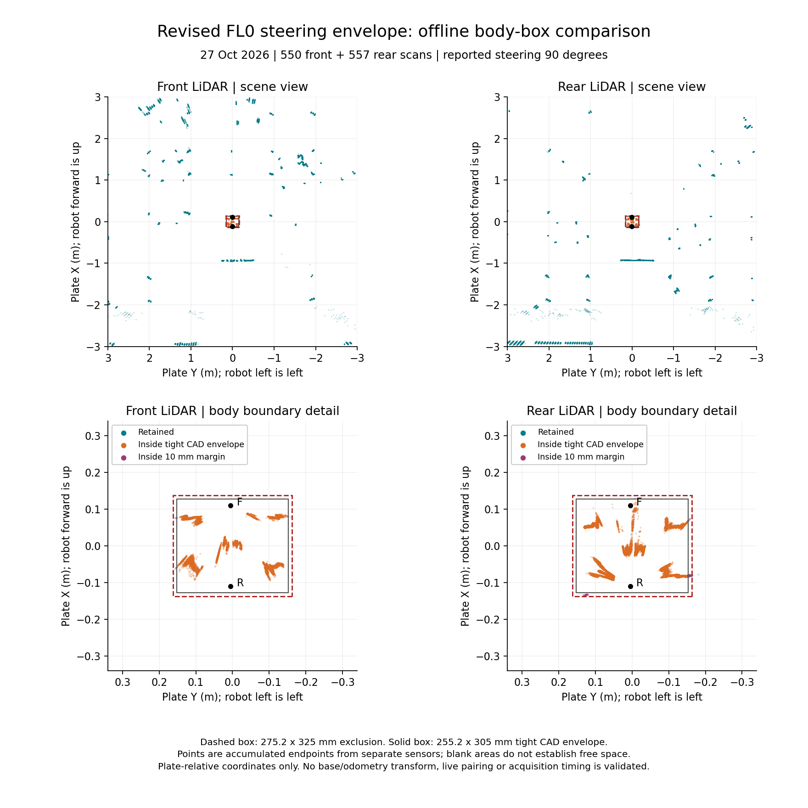

# Jetson stationary body-box view

Revision 2, 2026-10-27: the user supplied an FL0 LiDAR Specification and requested
its bounding box. This replaces the earlier 276 x 276 mm square with a
**275.2 x 325.0 mm rectangle**, including 10 mm margin per side. The tight CAD
envelope is 255.2 x 305.0 mm and includes the full 360-degree steering sweep.
Runtime desk defaults and raw scan topics are unchanged.

Live deployment subsequently succeeded on Jetson. The user built in
`/home/turtle/ros2_lidar_body_view_v2_ws` and started `jetson_lidar_relative_tf` and
`jetson_lidar_body_view` with `/home/turtle/lidar_body_view_v2.yaml`. A single
startup TF lookup warning was followed about 0.1 seconds later by a successful
pair and regular logs: 143-152 removed / 425-433 retained in the supplied samples.
Read-only SSH confirmed the exact revised parameters, one Best Effort cloud
publisher, and a 419-point message in `lidar_front_link` (20 bytes per point,
8380 data bytes). Startup log bounds are rounded to three decimal places.
Live publication and the subsequent saved-output verification below are complete.
Physical alignment and outside-target checks remain separate; the successful
software check does not measure mounting accuracy.

On 2026-10-27 the user authorized treating `FL0_LiDAR_Plan.pdf` as the real assembly
for integration. Front/rear plate-relative origins (+110,+5)/(-110,+5) mm,
scan height +26.5 mm, and front/rear scan-zero yaws pi/zero are now accepted
**assumptions**, not measurements. The clearance capture's steering was reported
as 90 degrees. Exact 90-degree CAD shadow reconstruction is not a prerequisite
for evaluating this rectangular mask.

The PDF SHA-256 is
`6a30bfef21fd90737cd2d48461a63be41bc904063edbbb643156adce6693f3ae`.
It does not identify the repository's base-to-plate transform. `plate_x`,
`plate_y`, and `plate_yaw` stay null; the earlier 28 mm ground-height estimate
stays explicitly provisional. Full robot-model launch still rejects unknown
plate placement. The desk launch, driver settings and merger defaults are unchanged.

Specification source: the user attachment
`/home/pa4/.codex/attachments/088b6c32-d6bc-4652-8015-cd34653f7bc7/Pasted text.txt`,
SHA-256 `12857cb0eff3ab74b577e90f16f5f243e6b19596749edcb588076542daf7eed9`.
Only the requested box revision is applied. Its example LaserScan filter chain,
mounting-hole modifications and CAD joint changes are not this implementation.

## Recorded live-output check

The user recorded `/home/turtle/jetson-lidar-filtered.W4XCaX/bag` from 09:34:50 to
09:35:31 KST on October 27 (40.3494 s). Read-only SSH retrieved the bag; matching
Jetson/local SHA-256 hashes are:

- `0_bag_2026_10_27-09_34_50.mcap`:
  `9220dd69361019a0470f0cd592ba1043decaa27e9453481108a99c390b592ce1`
- `metadata.yaml`:
  `f1cc2bb116a5e5468824a6ee0fa0822f549555f25b4d41aeed172c2c3efe0024`

`tools/lidar_body_review/review_live_cloud.cpp` reads saved data without ROS nodes
or hardware access. It checks the actual recorded transform and reconstructs each
cloud's contributing filtered scans, preserving point order and all five fields.

| Check | Observed result |
| --- | --- |
| Recorded messages | 405 front scans, 404 rear scans, 405 clouds, one static TF |
| Recorded relative TF | front -> rear, translation (+0.220,0,0) m, quaternion (0,0,1,6.1232e-17) |
| Complete pairs reconstructed | 404; exact XYZ, intensity, source ID and survivor order; maximum coordinate difference 0 |
| Cloud layout | All 405: `lidar_front_link`, height 1, FLOAT32 x/y/z/intensity/source_id, point_step 20, consistent width/row/data, dense, finite |
| Revised box | Zero surviving points inside inclusive front-frame X [-0.0276,0.2476], Y [-0.1575,0.1675] m |
| Header cadence | Front 10.0347 Hz, rear 10.0270 Hz, cloud 10.0273 Hz |
| Cloud header interval | 98.732–100.924 ms; no repeated/backward stamps |
| Points per cloud | 411–440, mean 425.47 |
| Removed per complete pair | 137–153, mean 145.90 |
| Matched input header skew | 0.03264–41.53752 ms, mean 15.67889 ms; within 75 ms limit |
| Cloud receipt minus header | 0.798–1.452 ms in this bag; not acquisition latency |
| Matched scan reuse | None |

The first cloud, stamp `1793061290734217185` ns, contains 233 front and 193 rear
points. Both corresponding raw scans are outside the captured raw sequences:
first front stamp `1793061290822344059`, first rear `1793061290832949079` ns.
Its 426 points pass layout/finite/source/bounds checks, but their raw provenance
cannot be reconstructed. The remaining 404 clouds match raw indices 0–403 from
each sensor. The final front scan, index 404, stamp `1793061331082490804` ns,
arrives after the last cloud, stamp `1793061331024340587` ns. This accounts for
the counts at the recording edges without an unexplained interior mismatch;
it does not establish what the recorder did before subscribing or after stopping.

Across the captured raw scans, reconstruction removes 24,890 front and 34,115
rear points, retaining 92,713 and 79,407 respectively. Every valid sub-0.30 m
return is inside the box in this capture; no valid return at or beyond 0.30 m
is removed. These totals include the final unmatched front scan and exclude the
first cloud's missing raw inputs, so they are not the live cloud totals. The
cloud stream contains 92,716 front and 79,600 rear points in total.

The result accepts the deployed stationary filtering behavior against the chosen
geometry. It does not establish physical extrinsic accuracy, coverage behind
occlusions, free space, scan acquisition synchronization or a motion-ready mapper
input. Both raw LaserScan topics remain unchanged and `time_increment=0`.

The user reports prior odometry testing on Jetson. The supplied workspace path
exists on the desktop but was absent from Jetson; the discovered older Jetson
deployment has an explicitly mock-only test result. The user is unsure whether
the recalled test used physical wheel feedback, so physical odometry remains
unverified; see the current handoff. Identify the drive controller and establish
its real-feedback setup, then establish the base-to-plate transform and define the
physical-origin LaserScan path and motion contract for SLAM. Plate X/Y/yaw remain
unknown, not inferred from this bag.

Verification: the new offline reader builds with warnings as errors, processes
all recorded messages, and the existing cloud-core tests pass. Local bag and final
analysis are `/tmp/jetson-filtered-review.6b4iQ9/bag` and `verified/` respectively.
Reproduce with the live-output section of `tools/lidar_body_review/README.md`.
Runtime code/configuration, live processes, hardware and Git index/history were
left unchanged; local analysis-tool and documentation edits remain uncommitted.

## Offline result

The tool in `tools/lidar_body_review` reused the merger's actual C++ projection
and exclusion functions on all 1,107 raw scans in the clearance bag. It also
checked the transforms independently in plate coordinates and verified survivor
order/intensity/source fields and exact point accounting. No ROS nodes were run
by this reader and no live pairing behavior is inferred.

| Metric | Front | Rear |
| --- | ---: | ---: |
| Scans | 550 | 557 |
| Valid input points | 143,167 | 149,348 |
| Inside tight CAD envelope | 35,364 | 51,435 |
| Inside only the 10 mm margin | 11 | 143 |
| Total removed | 35,375 | 51,578 |
| Retained | 107,792 | 97,770 |
| Returns below 0.30 m before | 35,376 | 51,584 |
| Returns below 0.30 m after old square | 127 | 713 |
| Returns below 0.30 m after revised rectangle | 1 | 6 |
| Returns at or beyond 0.30 m removed | 0 | 0 |
| Retained points per scan, min / mean / max | 184 / 195.99 / 207 | 165 / 175.53 / 187 |



The mask is X +/-137.6 mm, Y +/-162.5 mm in the plate frame, or X [-27.6,+247.6],
Y [-157.5,+167.5] mm in the front scan frame, inclusive and all Z. The runtime
projects both sensors into the front frame before filtering, so one correctly
placed box handles both. It classifies endpoint location, not physical identity.
It never turns excluded rays into free space. All-Z behavior is retained for this
existing cloud filter; the specification's example +/-5 cm LaserScan slab is not
a newly implemented filter here.

The specification explains the old square's residuals: steering axes at
(+/-64,+/-112) mm and 40.5 mm sweep radius give outer Y +/-152.5 mm before margin.
The new mask covers that stated CAD envelope. Seven sub-0.30 m samples remain
outside the specified Y bounds (front Y +163.715 mm; rear Y -163.454 to -180.201 mm).
Do not enlarge it merely until every close return disappears. A physical boundary
check should preserve known external targets beyond the chosen boundary. Mounting
assumptions, physical deviations and motion-ready scan behavior remain unvalidated.

Verification: new C++ tool builds with warnings as errors; existing cloud-core
tests pass, including revised corners, outside edges, the newly covered lateral
region, the slightly narrowed X boundary, and both sensors' asymmetric bounds.
The explicit YAML matches the reviewed geometry. Independent point transforms,
survivor fields/order and counts pass on the same 1,107 scans. The revised plot
was rendered and inspected. Prior model/launch guards passed; mounting config and
runtime implementation did not change in this revision.

## User-run Jetson step

Before deployment, read-only inspection found both raw driver nodes, their scan topics, no TF or
cloud topics, and no installed `lidar_cloud_merge` package. The source snapshot
is `/tmp/lidar-body-mask-v2.SS87Fc/jetson-lidar-body-view-20261027-v2.tar.gz` on the
desktop. It contains the unchanged merger package and the explicit view/mount
configs. It contains no compiled desktop binaries or robot-control packages.

If the previous merger is already built, no rebuild is needed. Copy the revised
`config/lidar_body_view.yaml` to Jetson and restart only the cloud node with that
file. The drivers and relative TF can keep running. The full commands below are
for a new deployment; the v1 bundle is historical and carries the old square.

The following commands are user-run. Keep the robot stationary. The already
running raw drivers stay in their current terminals. Stop this relative TF
before later running the robot model: exactly one publisher must own the rear
sensor transform.

On the desktop:

```bash
scp /tmp/lidar-body-mask-v2.SS87Fc/jetson-lidar-body-view-20261027-v2.tar.gz turtle@10.2.12.123:~/
ssh turtle@10.2.12.123
```

On Jetson, extract once and build in a separate workspace:

```bash
tar --keep-old-files -xzf "$HOME/jetson-lidar-body-view-20261027-v2.tar.gz" -C "$HOME"
source /opt/ros/lyrical/setup.bash
mkdir -p "$HOME/ros2_lidar_body_view_v2_ws"
cd "$HOME/ros2_lidar_body_view_v2_ws"
colcon build --base-paths "$HOME/jetson-lidar-body-view-20261027-v2/src" \
  --packages-select lidar_cloud_merge --cmake-args -DBUILD_TESTING=ON
```

In a dedicated Jetson TF terminal:

```bash
source /opt/ros/lyrical/setup.bash
export ROS_DOMAIN_ID=181 ROS_AUTOMATIC_DISCOVERY_RANGE=LOCALHOST
ros2 run tf2_ros static_transform_publisher \
  --x 0.220 --y 0 --z 0 --roll 0 --pitch 0 --yaw 3.141592653589793 \
  --frame-id lidar_front_link --child-frame-id lidar_rear_link \
  --ros-args -r __node:=jetson_lidar_relative_tf
```

In another Jetson terminal, after the build succeeds:

```bash
source /opt/ros/lyrical/setup.bash
source "$HOME/ros2_lidar_body_view_v2_ws/install/setup.bash"
export ROS_DOMAIN_ID=181 ROS_AUTOMATIC_DISCOVERY_RANGE=LOCALHOST
ros2 run lidar_cloud_merge stationary_cloud_merge --ros-args \
  -r __node:=jetson_lidar_body_view \
  --params-file "$HOME/jetson-lidar-body-view-20261027-v2/config/lidar_body_view.yaml" \
  -p stationary_test:=true \
  -r /lidar/points_merged:=/lidar/points_body_filtered
```

Exact bounds are X [-0.0276,0.2476], Y [-0.1575,0.1675] m. The existing startup
log rounds to three decimal places; consult the parameters for exact values.
Expect periodic removed/retained counts. The raw LaserScan topics remain unchanged.
Offline point totals do not prescribe live per-pair counts because pairing,
scene returns and scan availability vary. Ctrl+C stops each new process.

The output is stationary PointCloud2 visualization. It is not yet the first-map
input; that still requires a validated physical-origin LaserScan path, odometry,
base-to-sensor TF and a motion-compatible scan contract.

Local revision-2 analysis: `/tmp/lidar-body-mask-v2.SS87Fc/result` contains per-point
and per-scan classifications, geometry and the summary. Reproduce with
`tools/lidar_body_review/README.md`. The earlier result/figure remain historical
evidence of the square's behavior.
