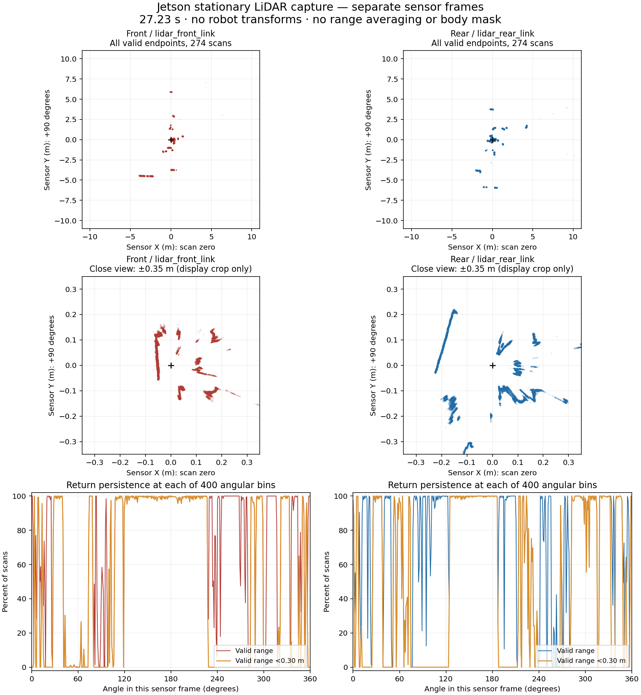

# Jetson stationary LiDAR capture review

Reviewed 2026-10-26 (Asia/Seoul). Both robot-mounted LiDARs produced consistent
raw scan messages in this 27.23-second capture. Many returns are close to the
sensors. The user confirmed the robot was **on the floor near objects or walls**,
so this capture cannot distinguish chassis returns from nearby scene objects.
No body mask or robot mounting transform was inferred or changed.

## Capture and method

- Jetson: `turtle@10.2.12.123`.
- Original: `/home/turtle/jetson-lidar-capture.2Vpg55/bag`.
- Local copy: `/tmp/jetson-lidar-inspection.Xx9zgN/bag`.
- Bag interval: 2026-10-26 20:44:59.395549956 to 20:45:26.629594127 KST.
- MCAP duration: 27.234044171 s; 548 LaserScan messages, 274 per sensor.
- MCAP SHA-256: `938c898cdd3c69d0f4cdcc0bdf98835c9f4b0287ecea484eb07c1a2ebe356148`.
- Metadata SHA-256: `fefeec2bcabe9090e36f0916210b7a25687245fe6f4e9c9bcb2ee19557c65b2d`.

SSH access was explicitly authorized by the user. Remote inspection read the bag,
metadata and ROS package manifests; the original capture and running hardware were
left unchanged. The local copy matched both remote hashes.

A temporary C++ reader used rosbag2_cpp and sensor_msgs deserialization, without
starting ROS nodes. It built with `-Wall -Wextra -Wpedantic -Werror`. Per-scan,
per-bin and all-valid-endpoint CSV files are under
`/tmp/jetson-lidar-inspection.Xx9zgN/scan_{scans,bins,points}.csv`; reader source,
CMake file and `summary.txt` are in that same temporary directory. Counts were
cross-checked against `ros2 bag info`, and CSV totals and strictly increasing header
stamps were checked independently. These are data consistency checks, not a physical
calibration or a regression test suite.

## Measured results

Here, a **valid bin** means a finite range within the message's declared limits.
It does not establish measurement accuracy or visibility beyond the return.

| Metric | Front | Rear |
| --- | ---: | ---: |
| Messages | 274 | 274 |
| Bins per message | 400 | 400 |
| Rate from first/last header stamps | 10.0415 Hz | 10.0378 Hz |
| Header interval minimum / median / maximum | 98.806 / 99.654 / 100.324 ms | 99.063 / 99.629 / 100.513 ms |
| Repeated or backward header stamps | 0 | 0 |
| Consecutive identical full range arrays | 0 | 0 |
| Valid samples / total bins | 81,921 / 109,600 | 85,912 / 109,600 |
| Valid fraction | 74.745% | 78.387% |
| NaN bins | 27,679 | 23,688 |
| Infinite or finite out-of-range bins | 0 | 0 |
| Valid bins per scan minimum / median / maximum | 287 / 299 / 307 | 301 / 314 / 323 |
| Valid range minimum / median / maximum | 0.050 / 0.128 / 8.248 m | 0.050 / 0.222 / 10.299 m |
| Valid returns below 0.15 m | 56.71% | 18.34% |
| Valid returns below 0.30 m | 66.55% | 59.86% |
| Angular bins never valid in this bag | 44 | 25 |
| Angular bins below 0.30 m in at least 90% of scans | 186 | 165 |

Both topics retain the expected sensor frame, 400 intensities, range limits
0.05–12 m and unchanged angular metadata. `time_increment` is zero throughout.
No approximately 200 ms scan gap appears in the recorded header intervals; that
supports continuity within this short capture, not a general no-loss guarantee.
The earlier CLI rate observations were from a different interval.

The median bag-receive-minus-header differences are 0.188 ms front and 0.209 ms
rear; maxima are 0.805 and 0.516 ms. These compare recorder receipt against the
driver's **publication stamp**. They do not measure optical acquisition delay,
UART/USB delay before publication, sensor synchronization or per-beam timing.

## Separate sensor views

Each column uses that sensor's own frame: +X is scan zero and +Y is +90 degrees.
Neither is labeled robot-forward. All valid endpoints from all 274 scans are
plotted; no range averaging, body mask, merging or duplicate suppression is applied.
The middle row is a display crop, not a filter. Empty regions and NaN bins do not
establish free space.

A broad front sector from approximately 119.7° to 226.8° has returns below
0.15 m in at least 90% of scans. A rear sector from approximately 125.1° to
186.3° has returns below 0.30 m at that persistence. Those are **sensor-frame
observations**, not robot-body exclusion sectors. Nearby objects and walls are
a known confounder in this capture. The data also contain longer-range returns;
the low median ranges alone do not diagnose a driver or mounting defect.

## Jetson software boundary

Read-only manifest inspection found `rosbag2_storage_mcap` 0.33.3 under
`/opt/ros/lyrical`. `slam_toolbox`, `nav2_bringup`, `nav2_amcl` and
`robot_localization` were absent from that prefix. The desktop audit's installed
mapping/navigation packages must not be assumed present on Jetson. No packages
were installed during this inspection.

## Next bounded check

Keep the mounting and driver configuration fixed, clear nearby external objects
from the close-view region where practicable, and record one more short stationary
bag. Note the distances to any remaining wall or object. Comparing the two bags
can identify returns that change with the scene and candidates that remain attached
to the robot; persistent returns alone still require physical identification before
masking. This is a scene/occlusion check, not a renewed fine-timing investigation.

First-map work still needs a mapper decision, robot extrinsics, accepted odometry
and an appropriate scan-admission/motion contract. The stationary experimental
guard remains enabled. These results do not authorize continuous-motion SLAM or
navigation clearing from the merged cloud.
