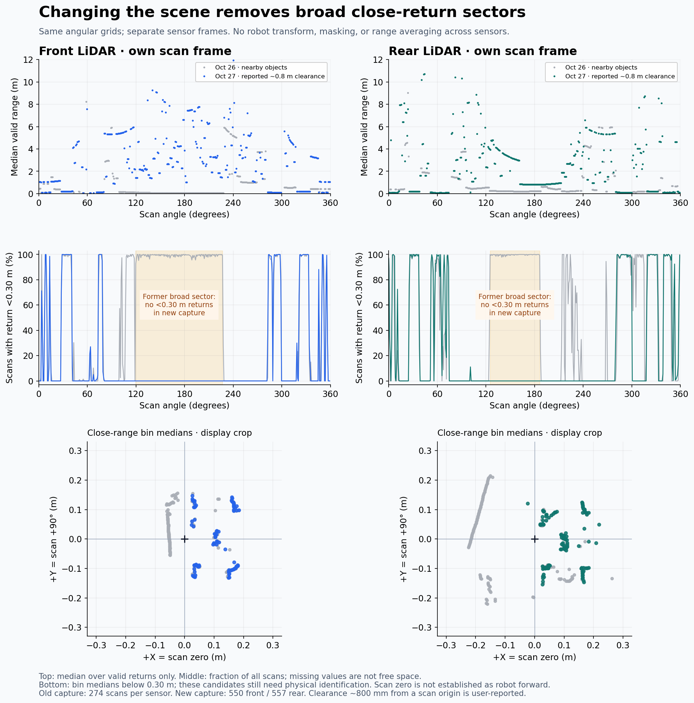

# Jetson scene-clearance comparison

Reviewed 2026-10-27 (Asia/Seoul). The second stationary raw capture removes the
large close-return sectors seen on October 26. Smaller near-field clusters remain
at similar sensor angles and ranges. This supports scene-dependent returns in the
old broad sectors and stable robot-attached or sensor-related candidates elsewhere;
it does not identify the remaining returns as specific chassis parts.

Later on October 27 the user accepted the supplied FL0 drawing as the assembly
geometry and asked to proceed. The resulting [offline body-box review and Jetson
step](jetson_lidar_body_view.md) supersede the geometry-gathering prerequisite
below for this stationary mask experiment. Plate-to-base placement remains unknown.

## Conditions and provenance

- New Jetson capture: `/home/turtle/jetson-lidar-clearance.nm615e/bag`.
- Original scene note: `800 mm`. The user clarified that this distance was
  approximately from a LiDAR scan origin. It is a reported approximate clearance,
  not a measured all-direction scene survey.
- The user subsequently reported the wheels were at **90 degrees** during this
  capture, in response to the CAD reference-pose discussion. This is a reported
  steering arrangement; no recorded joint states establish calibrated angles or
  per-module signs. The October 26 steering arrangement was not separately confirmed.
- Procedure requested unchanged mounts/settings, a stationary robot, and clearing
  nearby external objects. Physical invariance was not independently surveyed.
  The two bags have matching angular grids and expected scan frame names.
- Baseline: `/home/turtle/jetson-lidar-capture.2Vpg55/bag`, October 26, on the floor
  near objects or walls; see [original review](jetson_lidar_capture_review.md).
- New bag interval: 2026-10-27 08:14:11.442607690–08:15:06.816559224 KST.
- Duration: 55.373951534 s; 1,107 messages: 550 front, 557 rear.
- New MCAP SHA-256:
  `63d6fc0daea8c255f07dbfadca54b49cd82b6ae3ec745e807baf13e4dbe3c438`.
- New metadata SHA-256:
  `db69d86af35f33cb580612f7165c1289b6120e1bcbbcf4b72b0308bce5ca7c22`.

The bag and original scene note were copied through authorized read-only SSH.
Local hashes match the remote files. No remote hardware commands, parameter
changes, TF, filtering or Git operations were performed.

## Recorded continuity

| Metric | Front | Rear |
| --- | ---: | ---: |
| Scans | 550 | 557 |
| Rate from first/last header stamps | 9.9180 Hz | 10.0440 Hz |
| Header interval min / median / max | 99.089 / 100.712 / 102.740 ms | 98.781 / 99.596 / 100.303 ms |
| Repeated/backward stamps | 0 | 0 |
| Consecutive identical range arrays | 0 | 0 |
| Metadata changes within capture | 0 | 0 |
| Bins per scan | 400 | 400 |
| Valid returns / total bins | 143,167 / 220,000 | 149,348 / 222,800 |
| NaN bins | 76,833 | 73,452 |
| Infinite / finite out-of-range bins | 0 / 0 | 0 / 0 |

The differing message counts are consistent with the observed slightly different
publication rates. No approximately 200 ms gap appears in either recorded header
sequence. This is bounded continuity evidence, not proof of no internal sample
loss. The front stream's modest interval variation is not a reason to reopen the
deferred timing investigation from this capture alone.

All `time_increment` values remain zero. Median bag-receive minus publication-stamp
intervals are 0.168 ms for both sensors (maxima 0.510 / 0.453 ms). These do not
measure acquisition time, optical latency or per-ray synchronization.

## Scene comparison

A valid return is finite and inside the message's declared 0.05–12 m range.
Near-return percentages below use valid samples as their denominator. Persistent
angular bins have a return below 0.30 m in at least 90% of **all scans** in that bag.

| Metric | Front, Oct 26 | Front, Oct 27 | Rear, Oct 26 | Rear, Oct 27 |
| --- | ---: | ---: | ---: | ---: |
| Valid fraction of all bins | 74.75% | 65.08% | 78.39% | 67.03% |
| Median valid range | 0.128 m | 2.661 m | 0.222 m | 0.866 m |
| Valid returns below 0.15 m | 56.71% | 13.39% | 18.34% | 23.19% |
| Valid returns below 0.30 m | 66.55% | 24.71% | 59.86% | 34.54% |
| Persistent angular bins below 0.30 m | 186 | 53 | 165 | 81 |
| Angular bins never valid in that capture | 44 | 31 | 25 | 16 |

Changing the scene changes return statistics and their denominators. The lower
overall valid fraction does not establish a driver regression; NaN bins do not
establish free space. The rear's percentage below 0.15 m increases while its broad
0.15–0.30 m sector disappears, so a single near-return percentage is insufficient.

The strongest comparison is at matching angular bins:

| Earlier broad sector (sensor coordinates) | Old capture | New capture |
| --- | --- | --- |
| Front 119.7°–226.8° (120 bins) | 99.16% of all sector samples below 0.15 m | **Zero samples below 0.30 m**; valid fraction 66.29% |
| Rear 125.1°–186.3° (69 bins) | 99.72% of all sector samples below 0.30 m | **Zero samples below 0.30 m**; valid fraction 93.14% |

Median of valid per-bin medians in those sectors changes from 0.059 to 3.2865 m
front, and from 0.215 to 2.974 m rear. These are summaries of per-bin medians,
distinct from the all-valid-return medians in the table above.

There are 51 front and 71 rear bins persistently below 0.30 m in **both** captures.
For those shared near bins, the median absolute change in their range medians is
2 mm front and 1 mm rear. This is repeatability across these records, not a range
accuracy estimate. There are also 2 front / 10 rear newly persistent near bins.

The top row plots per-bin medians of valid returns; the middle row plots the
fraction of all scans below 0.30 m. The bottom row displays close-range per-bin
medians in each sensor's own XY frame. It is a visualization crop, not a filter.
No points are transformed into a robot frame or averaged between sensors.
Scan zero is not established as robot-forward.

## CAD reference and reported steering

The user supplied `/home/pa4/Downloads/FL0_LiDAR_Plan.pdf` on October 27. Its
two pages describe scan-plane cross-sections of
`TB3_WafflePi_Swerve_V2_WristRoll v1`, with sensor positions (+110,+5) and
(-110,+5) mm relative to the FL0 top-face centre and scan height +26.5 mm.
It assumes front scan zero rearward and rear scan zero forward. Optical origins,
scan height and these scan-frame directions remain provisional installed geometry.

The solid shadows and exact wheel/motor rows are for **0-degree steering**.
The user reported **90-degree steering** for the capture. Consequently, the
earlier chat comparison of wheel/motor clusters against those rows is only a
candidate association, not validation of a matching CAD pose. The pale 360-degree
sweep gives possible blockage over steering configurations, not the exact shadow
at 90 degrees. Do not rotate scan bearings by 90 degrees: each module rotates
about its own steering pivot while the LiDAR origins remain fixed.

Standoff locations are unchanged by steering. Front standoff predictions at
7.3-10.2 degrees / nearest 108.6 mm and 13.4-16.2 degrees / nearest 111 mm agree
approximately with persistent observed bins at 8.1-9.0 degrees / medians 105-109 mm
and 13.5 degrees / median 112 mm. The plan's opposite-housing prediction near
front scan zero at nearest 202.4 mm does not match that bin's measured median
1.044 m; steering alone does not resolve this fixed-geometry discrepancy.

An exact wheel/motor comparison needs the cross-section at the reported installed
steering pose or source geometry with defined joint pivots and angle conventions.
The existing capture is sufficient for that offline comparison. It does not
require repeating the clearance capture or changing the working desk setup.

## Decision and next boundary

The bounded scene-clearance comparison is complete. Do not turn the former broad
sectors into a permanent body mask. The remaining small stable clusters are
appropriate targets for physical inspection of supports, brackets, wheels and
cables at scan height, with sensor artifacts still an alternative explanation.
A photograph can help identify likely parts; it cannot establish exact optical
origins or the missing base-to-sensor transforms.

Current `config/lidar_mounts.yaml` still has null `plate_x`, `plate_y`,
`plate_yaw`, `front_yaw` and `rear_yaw`. The +/-110 mm sensor positions, +5 mm
lateral offset and 54.5 mm derived scan height remain provisional. Next integration
work should obtain the installed mounting references and check sensor scan-zero
directions, then validate stationary robot-frame observations. Keep the working
desk setup and raw streams intact. Measured odometry and a compatible mapping
input/timing contract remain prerequisites for the first map.

## Analysis artifacts and reproduction

Local analysis directory: `/tmp/jetson-lidar-clearance-review.2DP3W2` (temporary).
It contains the copied bag and scene note, reused raw-scan C++ analyzer, per-scan,
per-bin and endpoint CSVs, `summary.txt`, a C++ comparison program,
`comparison_bins.csv`, `comparison.txt`, and the figure-generation script.

The existing C++ reader from `/tmp/jetson-lidar-inspection.Xx9zgN` was reused
without changes. The comparison program builds with C++17 and
`-Wall -Wextra -Wpedantic -Werror`; it requires both grids to have 400 matching bins.
Counts agree with bag metadata and recorded timestamps. Python is used only for
plotting the C++ analysis outputs. The figure was visually inspected.

The local evidence archive `jetson_lidar_clearance_evidence_20261027.zip` in the
analysis directory preserves the new raw bag, original scene note, analyzer and
comparison sources, plot script, summary/per-bin/per-scan data for both captures,
the comparison figure and the initial report snapshot, before the later CAD and
90-degree steering clarification above. The earlier raw bag remains at its original
Jetson path and in the previously attached October 26 Notion evidence archive.
Neither a live SLAM test nor a physical calibration was performed by this analysis.
