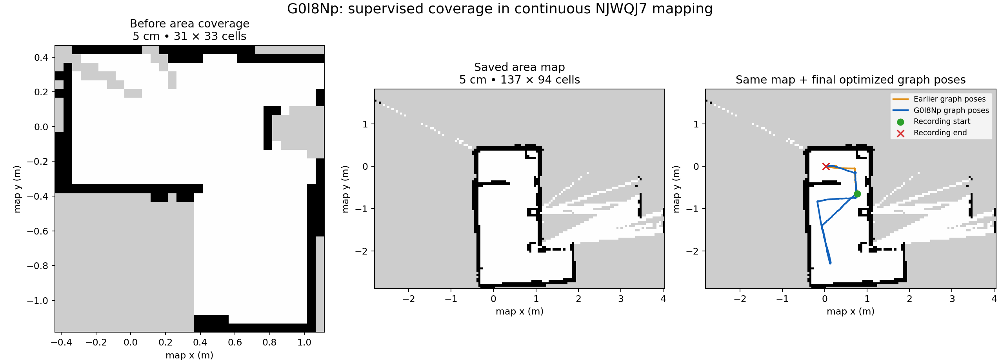
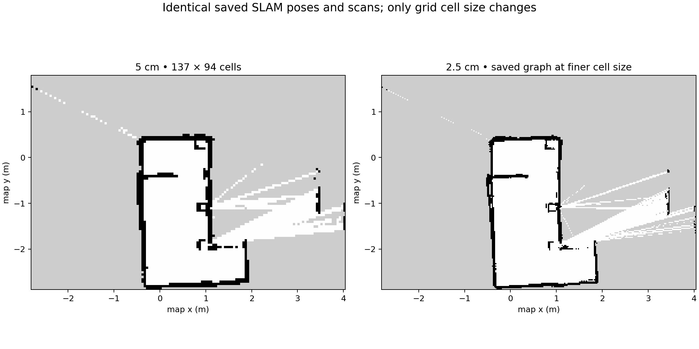

# Supervised area mapping — G0I8Np

2026-10-27, 18:44–18:57 KST. The user completed 48 finite segments in continuous
NJWQJ7 mapping and finished with `q`. They confirm every segment stopped completely
on its own, with no intervention, manual repositioning or scene change during
this recording, and that they passed an earlier passage. Coverage of every
reachable part of the arena has not been established.

The recording and input checks pass. This is useful area mapping evidence,
not a measurement of absolute map accuracy or an autonomous-navigation result.
Wheel calibration remains assumed, plate offsets remain zero, and LiDAR settings,
socket identities, mount, masking and nominal timing hypothesis are unchanged.

## Evidence and scope

- Recording: `/home/turtle/jetson-mapping-session.G0I8Np`.
- Saves: `/home/turtle/jetson-area-checkpoints.xFPjny/after.{pgm,yaml}` and
  `after_graph.{posegraph,data}`. Map saving succeeded; serializer returned zero.
- Desktop copy: `/tmp/jetson-mapping-area-G0I8Np`; analysis: `review/`; exact saved
  graph renders: `graph-resolution/` and `before-graph-resolution/`.
- Earlier attempts: `/tmp/jetson-mapping-area-earlier-attempts`. The user confirms
  commanded movement before G0I8Np. Seven earlier console captures contain eight
  started segments in total, with incomplete results. Their odometry endpoints
  join the following starts exactly, explaining the changed initial pose/map.
  Their exit causes were not supplied; do not label them completed runs or apply
  G0I8Np's stop confirmation to them. The original 18:29 checkpoint predates them.
- Source transcript: attachment `976b09a5-23b3-47eb-836f-33a0ffba2e19/Pasted text.txt`.

The saved-map comparison includes the earlier commanded movement. G0I8Np itself
starts with a 78 x 87 grid and graph node 105, not the 31 x 33 pre-coverage map.
It contributes 597 new-node events; the final serialized graph has 702 scans and
1,092 edges, versus 13 scans / 18 edges in the earlier checkpoint. Graph edges
include ordinary sequential and nearby-scan constraints; their count is not a
loop-closure count. The 13 old nodes' corrected poses are unchanged between saves.

SHA-256, matched between Jetson and desktop:

| Artifact | SHA-256 |
| --- | --- |
| G0I8Np SQLite bag | `0e1f2889c400941533d8b75d13d4c1d0c31f97df261f40e4bc9cc8587a11cdff` |
| after.pgm | `74320bceb005d283ff82c088bd91b52f3af9b4cfb1ffbb5525b60e3bb63f3b3c` |
| after_graph.posegraph | `cc7443e0a29ffe9dd26f7c34ef39055238173a628a9b5e0a263a92051be1784d` |
| after_graph.data | `18fa15e841dd6ca7c3d22e9258469a9280fdff4e0550444b0eed7e8479e91ab9` |

## Recording and motion

| Measurement | Result |
| --- | ---: |
| Odometry-recorded duration | 759.320 s |
| Completed segments | 48: 20 straight, 28 turns |
| Sum of straight-segment travel | 5.757 m |
| Integrated odometry path, including turns | 5.783 m |
| Motion / zero command publications | 3,725 / 240 |
| Odometry / corrected scans / status samples | 37,967 / 7,610 / 759 |
| Maps / joint-state messages | 380 / 75,896 |
| Maximum within-segment command gap | 112.882 ms |
| Maximum odometry / scan-bracket gap | 34.191 ms |
| Peak pose-derived translation / yaw rate | 0.025719 m/s / 0.103428 rad/s |
| Scans bracketed by odometry | 7,610 / 7,610 |
| Minimum finite returns per scan | 257 |
| New input rejections / fault / stale status samples | 0 / 0 / 0 |
| Joint messages with nonfinite position/velocity | 0 |

Every completed segment has its recorded finite motion count followed by five
zero commands. The large input rejection total, 12,749, is unchanged throughout
the recording; it accumulated during the earlier motor-power interruption.
Raw `physical_stop_confirmed=false` remains untouched; human confirmation is
recorded here separately.

The first command after changing movement type often falls short: some 30-degree
turns measured about 26.3–26.7 degrees, and some 30 cm moves about 28.6–28.7 cm.
This is consistent with steering alignment consuming part of the fixed command
window. The runner does not extend that window to force exact travel. Subsequent
30-degree turns commonly ended near 30.6–30.9 degrees. The rejected `l 5` was
outside the existing 10–30-degree command range and started no segment. These
are odometry observations, not independent angle/distance measurements.

## Map quality and revisits

The last bag map exactly matches saved `after.pgm`: 137 x 94 cells at 5 cm,
548 occupied, 2,634 free and 9,696 unknown. Bounds are about 6.85 x 4.70 m,
including substantial unknown space; they are not dimensions of a completely
surveyed arena. Free cells represent about 6.585 square metres.

The central walls and passage boundaries look coherent. Sparse ray patterns and
incomplete boundaries extend to the right and outside the main observed region.
Their physical cause is not determined here. They should not be read as confirmed
traversable coverage or fixed by changing occupancy resolution.

The user revisited an earlier passage, but there were **zero recorded loop-closure
events** and zero pose-graph topic messages; 597 new-node events were recorded.
Missing optional topic data cannot by itself prove the absence of all internal
closures. The saved graph provides final geometry, not a complete event history.
Do not claim a validated loop closure from the revisit alone.

During G0I8Np, the map->odom correction changed by up to 0.545 m in translation
and 21.696 degrees relative to its initial transform. At the end the difference
was 0.116 m / 6.540 degrees. These are coordinate-transform changes, not measured
ground-truth error and not a basis for changing the assumed wheel calibration.
They do justify comparing a long wall and a passage width against physical
measurements before autonomous navigation. The diagnostic plot is retained at
`/tmp/jetson-mapping-area-G0I8Np/review/map_correction.png`.

## Saved graph and resolution

Both saved graph/data pairs load on the desktop, and their 5 cm renderings match
the respective saved PGM pixels exactly. The final bag map matches too. Thus the
2.5 cm comparison uses the exact saved optimized poses and scans, unlike the older
caGdIe frozen-odometry comparison. No new scan matching or optimization occurs.
This validates archive loading and rasterization, not ROS node restart,
continued mapping after deserialization or physical relocalization.

| Grid | Dimensions | Occupied / free / unknown |
| --- | --- | --- |
| 5 cm | 137 x 94 | 548 / 2,634 / 9,696 |
| 2.5 cm | 274 x 187 | 1,467 / 10,022 / 39,749 |

Thresholds remain min_pass_through=2 and occupancy_threshold=0.1, verified from
the live parameter dump. They are explicit renderer inputs because this Karto
archive does not serialize those two parameters. Grid origins use full precision;
the map-saver YAML rounds them to millimetres. The finer grid preserves the same
geometry with finer boundary sampling; it does not add observations or accuracy.

New local-only C++ renderer: `tools/lidar_diagnostics/render_mapping_graph.cpp`.
Both resolution targets build with C++17 warnings as errors. Validation covers
before/after PGM equality, bag-versus-saved-map equality, missing-input rejection
and refusal to overwrite an existing output directory. No hardware/Git operation
was executed by the assistant.

## Next work

Continue supervised coverage only where reachable passages remain unobserved,
using fresh physical clearance and meaningful revisits, then save into a new
checkpoint directory so xFPjny's evidence remains intact. There is no requirement
to repeat the small reverse/return test. Check physical dimensions against the
saved map; resolve the sparse outside observations before navigation uses them.
The 2.5 cm map is available offline now. Keep continuous NJWQJ7 at 5 cm until a
continuation/restore procedure is validated; no reset is needed for more coverage.

At the 18:58–18:59 read-only check, input was fresh with published=59459,
rejected=12749 unchanged, fault=0, no command publisher, and battery about 11.8 V
(recent minimum 11.7 V). These are historical observations, not continuing monitoring.
