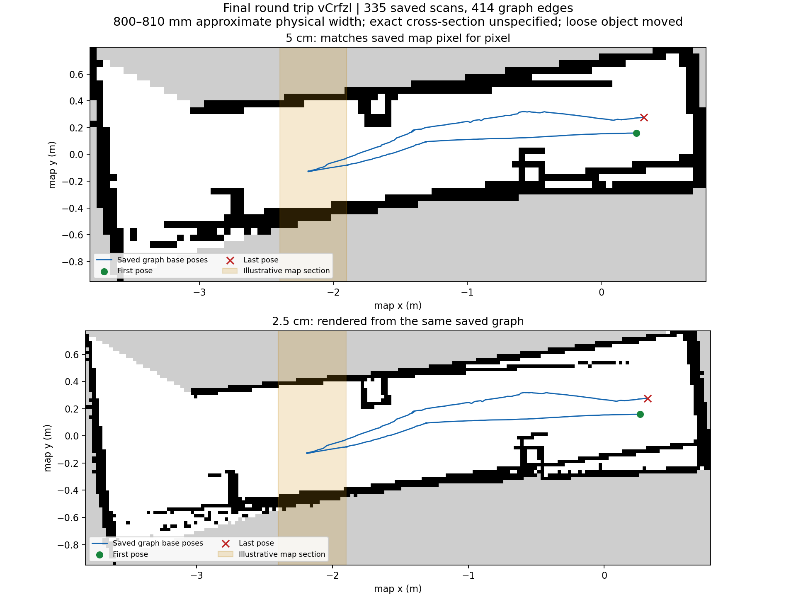

# Final round-trip review — vCrfzl, 2026-10-27

The user ended physical experimentation after one round trip in the revised
layout. Console v2 completed 29 bounded segments. The user confirms every segment
stopped automatically without intervention, reports an approximate wall spacing
of **800–810 mm**, and says **a loose object moved on the return leg**. No long-wall
A–B length or identifiable passage cross-section was supplied. This is useful
recorded mapping evidence; it does not establish absolute dimensional accuracy,
a controlled unchanged-scene revisit, full arena coverage or navigation readiness.
No further driving is requested.

## Scene and provenance

Before this run the user changed wall panels/passage geometry, without manually
moving the robot or restarting the wheel launch. The user restarted the proven
combined front-input/SLAM launch for a fresh map, keeping wheel odometry continuous.
The old NJWQJ7 map and G0I8Np data remain earlier-layout evidence.

| Item | Jetson path / value |
| --- | --- |
| Fresh mapping session | `/home/turtle/jetson-map-dimensions.w9hxqM`, started about 19:55 KST |
| Completed console v2 session | `/home/turtle/jetson-mapping-session.vCrfzl`, about 19:55:43–20:03:38 |
| Independent recorder | `/home/turtle/jetson-mapping-console-v2/runs/bag_20261027T195454_502949284`, 19:54:55–20:08:27 |
| Final checkpoint | `/home/turtle/jetson-mapping-console-v2/runs/map_20261027T200721.aXvQas` |
| Pre-restart checkpoint | `map_20261027T195401.yA4OhZ`; can contain mixed old/new observations, not used here |
| Local analysis | `/tmp/jetson-final-roundtrip-vCrfzl` |

The recorder started before the fresh mapper and includes its first scan/node,
335 new-node events, transient static transforms and robot description. It closed
cleanly before retrieval; metadata counts and SQLite integrity check pass. No
live database was treated as a completed recording. Final checkpoint checksums
match the Jetson originals; map saving succeeded and graph serialization returned
`result=0`. The map-saver lifecycle warning did not prevent a valid saved result.

All assistant operations were local editing/offline analysis or read-only SSH.
No assistant deployment, hardware operation or Git command occurred. The user
had already verified the v2 source manifest and built it on Jetson.

## Motion and input evidence

| Quantity | Result |
| --- | ---: |
| Console recording duration | 474.020 s |
| Completed segments | 29: 18 straight, 11 turns |
| Summed straight travel from odometry | 5.169 m |
| Motion / zero commands | 2,533 / 145 |
| Zero commands per completed segment | 5, verified against recorded messages |
| Largest in-segment command gap | 112.291 ms |
| Largest console odometry gap | 33.305 ms |
| Console corrected scans / maps | 4,754 / 238 |
| Ignored ordinary-input batches | 2; run continued to deliberate `operator_finished` |
| Console fault / stale status samples | 0 / 0 |
| Rejection counter during console | 16, unchanged |
| Nonfinite joint feedback messages | 0 |

The original `result.json` contains `physical_stop_confirmed: false` because the
program cannot observe the user's physical confirmation. It is preserved without
editing. The user's later confirmation is recorded separately here and in the
package's `operator_observations.json`. It applies to automatic stops, not to an
unchanged scene: the loose-object move is explicitly retained.

One console scan precedes its first locally recorded odometry message by 37.416 ms,
before any commanded motion. The independent recorder supplies the missing
preceding odometry. All 4,754 console scans and all 8,002 independent scans are
bracketed by independent odometry. This was a console recording boundary, not an
in-motion odometry outage. All 2,678 commands in the independent bag equal the
console commands field for field, including timestamps and frames, with no extra
commands. Serialized bytes differ, so byte identity is not claimed.

The independent bag contains 228,845 messages, including 40,579 odometry,
81,153 joint-state, 94,895 dynamic-TF, 2 static-TF, 1 robot-description, 8,002 scan,
801 status, 399 map, 335 new-node and 2,678 command messages. Four stale-status
samples occur during frontend startup; console motion starts after fresh input.
No fault sample was recorded. Pose-graph and loop-closure-event topics contain
zero messages. Zero captured closure events and a physical return are not proof
of successful loop closure.

## Saved graph and resolution

The C++ offline renderer loaded the final `.posegraph` and `.data`: **335 saved
scans, 414 edges, one laser**. It performs no new optimization or scan matching.
Explicit original occupancy parameters are min-pass-through 2 and threshold 0.1.

| Raster | Dimensions | Occupied / free / unknown cells |
| --- | --- | --- |
| Saved / rendered 5 cm | 92 × 35 | 483 / 1,412 / 1,325 |
| Same graph rendered at 2.5 cm | 184 × 69 | 1,258 / 6,035 / 5,403 |

The saved map, last console map, last independent map and rendered 5 cm map have
identical pixels. The saved YAML rounds the origin to millimetres; the renderer
retains the full origin `(-3.81753012621316, -0.950635260876612)`. Original YAML
thresholds and files are retained. The raster bounds include unknown cells and
are not measured room dimensions. The 2.5 cm result is available for offline use
now; finer cells do not repair inconsistent observations or increase physical
measurement accuracy. Live mapping stayed at 5 cm throughout this experiment.

The blue curve shows saved graph base poses, not ground truth. Some wall traces
are thick or separated. The loose-object change is known, but its time/location
and contribution to these traces are unknown; do not attribute all discrepancies
to that object, wheel calibration or LiDAR timing from this evidence alone.

The online map-to-odom transform changed by up to 0.457 m / 10.348 degrees from
its initial value. The recorded online map endpoint separation is 0.133 m, while
odometry endpoint separation is 0.478 m; endpoint heading differs by about
176 degrees. These are internal pose estimates, not measured return errors or
claims that the robot physically missed an intended point by those amounts.

## Approximate passage reference

Physical reference: **800–810 mm**, approximate, with no identified map
cross-section, before/after measurement timing, repeated readings or measurement
uncertainty. The user clarified that the return-leg change was a loose object,
not a wall-panel change. We do not impose another experiment to fill these gaps.

For illustration only, select the uninterrupted central band `map x = -2.4 to
-1.9 m`, shaded above. At each grid column, measure the vertical gap between the
inward faces of the nearest occupied cells in the upper/lower wall bands. This
is a raster opening, not fitted physical wall-surface separation; the walls are
slightly slanted, and discretization/thickening and cell selection affect it.

| Grid | Illustrative opening range | Median |
| --- | --- | --- |
| 5 cm | 750–800 mm | 750 mm |
| 2.5 cm | 775–800 mm | 800 mm |

The fine-grid range is near the supplied approximate physical width. **Do not
turn it into a signed error or percent-accuracy claim:** correspondence to the
measured section is unknown. One cell at either selected boundary changes this
measurement by 50 mm at 5 cm, or 25 mm at 2.5 cm; opposite boundary choices can
compound that. The supplied 10 mm physical range is smaller than either cell.
No long-wall comparison can be computed without the physical A–B length and
corresponding endpoints. The round trip remains a useful dataset with a rough
scale check, not completed dimensional validation.

## Preserved integration and teammate handoff

Front corrected scan only, 1,600 bins and NaN unknowns; front mount from
`base_footprint` remains xyz `(0.110, 0.005, 0.0545)` m / yaw pi. Body mask,
USB connections and motion limits are unchanged. Wheel calibration is assumed
correct; plate x/y/yaw remain zero. Timing remains nominal, assumed delay zero,
`acquisition_time_valid=0`. No moving rear-LiDAR or IMU validation is implied.

The teammate now has the requested independent bag, saved occupancy/graph,
robot description, frame contract and analysis in
`wheelbase-final-roundtrip-20261027-v1.tar.gz`, alongside the earlier data and v2
source archives. The final archive is a separate new-layout dataset; the old
archives remain unchanged. Nothing has been sent to the teammate.

The base-frame front-box RViz direction check was never performed. Yaw pi is the
preserved configured value, not a newly verified correction. Only under identical
base axes/scan conventions is the teammate's absolute `NT_SCAN_YAW` equivalent
`3.141592653589793`. Do not mark orientation verified or alter the live TF/URDF.
The final package labels this unresolved item explicitly; no additional physical
experiment is requested.

## File integrity and closeout

SHA-256 of the console DB:
`75d01368be030d3aa23281e4a92ba1b995e1b40c4196f9d553fc500e1861626d`.
Independent DB:
`3a5ee3c060e858c281a4770571b2db90f8f2f52095aebd830e279e2f3cca69ef`.
Final graph posegraph:
`055d957b7b7697e1b428bf0c55969ea4d3fa8c68e2891a7edd7a07fcf5e6e0f6`.
Final graph data:
`4a5078c216461381cb1e2fb2f0d13cd04f2db4f4703bdb7bc8e010900e2dbdaa`.
Full file manifests and verification details are included in the archive.

The console and recorder have exited. The last read-only process check still
showed wheel launch PID 4948 and mapping launch PID 16782; subsequent shutdown
is not confirmed. With the robot stopped, the user may Ctrl+C mapping, wait for
the prompt, Ctrl+C wheel launch, wait for its prompt, then switch off motor power.
If removing Jetson power, perform normal OS shutdown first. The assistant does
not execute these commands. No further driving, map reset or live resolution
change is needed for this final experiment.
