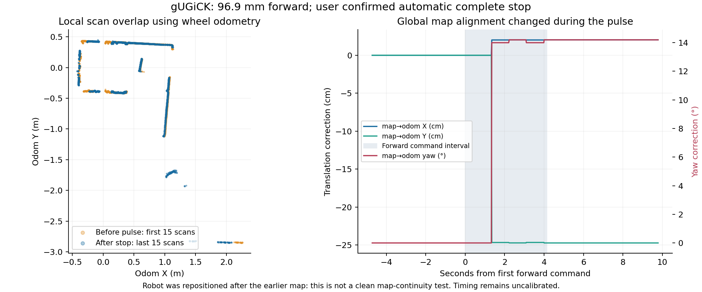

# Live mapping movement review — gUGiCK

2026-10-27, Asia/Seoul. The user ran one bounded forward pulse, observed movement
and confirmed a complete automatic stop without Ctrl+C or a motor-power cut.
The same user subsequently confirmed that the robot had been repositioned between
the first stationary map and this pulse. This changes the interpretation of the
large map-frame correction: the run is useful motion/input evidence, but it is not
a controlled map-continuity test from the earlier placement. It does not by itself
establish a SLAM fault or a valid map recovery.



## Saved evidence

- Motion recording: `/home/turtle/jetson-mapping-motion.gUGiCK`.
- Updated snapshot: `/home/turtle/jetson-map-after-forward.hg0j10/after_forward.{pgm,yaml}`.
- Earlier snapshot: `/home/turtle/jetson-map-snapshot.gjlydJ/stationary.{pgm,yaml}`.
- Desktop copy: `/tmp/jetson-moving-map-gUGiCK`; C++ analysis output in `review-v2`.
- Read-only SSH confirms the original wheel controller, front mapping input and
  mapper remain running; the temporary motion runner has exited. No hardware,
  remote configuration, or Git command was executed by the assistant.

Desktop/Jetson hashes match:

| File | SHA-256 |
| --- | --- |
| Motion bag SQLite | `a9ceb67619af398ef0228ca4012c5cf25bcfc74376d8407c553b84f4579edd30` |
| result.json | `f7ffcdc9f50d5f2d41f1edb67a6797088faa057ee199cede0fa191ad6a982318` |
| after_forward.pgm | `a72c6c27163c5d9444731de7673b1840893eadeba07d67cb067054f5923c3358` |
| after_forward.yaml | `0126c0a4220278613045ed1061a23971b2a1614155ff6cc8bcf6ee9bc5991697` |

The reader independently deserialized all 2,518 messages: 679 odometry, 128 scans,
13 input-status messages, nine maps, 1,642 dynamic TF messages, two static TF
messages and 45 commands. Odometry reconstructed from the bag matches the runner's
CSV byte for byte. Earlier/updated saved PGM pixels exactly match the first/last
maps in the bag. All saved maps are trinary (unknown, free, occupied).

## Motion and input results

| Measurement | Result |
| --- | ---: |
| Forward travel relative to baseline | 96.919 mm |
| Maximum lateral displacement | 0.196 mm |
| Maximum yaw change | 0.001762 rad, about 0.101° |
| Forward / explicit-zero publications | 40 / 5 |
| First forward to first zero publication | 4.141 s |
| Largest publication interval | 105.481 ms |
| Maximum odometry gap | 20.148 ms |
| Maximum pose-derived translation speed | 0.02885 m/s |
| Maximum pose-derived yaw rate | 0.01019 rad/s |
| Last measurable pose change after first zero | 0.425 s |
| Constant final odometry span | 5.200 s |
| Corrected scans / during command interval | 128 / 41 |
| Median scan reference interval | 99.775 ms |
| Estimated reference-to-recording age | 27.352–51.185 ms |
| Finite returns | 36,096 total; 274–287 per scan |

Every recorded input status has fault=0, fresh=1, rejected=3 unchanged; published
advances from 17,556 to 17,676. Nominal timing and assumed delay zero remain explicit
hypotheses, acquisition_time_valid=0. Reference-to-recording age is not a calibrated
sensor latency. This bag contains corrected output, not new raw timing provenance.
The runner's `physical_stop_confirmed=false` is retained in the original file:
physical confirmation comes from the user's separate observation, not software.

## Local scan consistency

The offline C++ reviewer interpolates wheel odometry at each corrected scan's
estimated reference time and applies the accepted front mount (.110,.005,pi).
It does not deskew again, fit odometry, estimate delay, or run ICP. All 128 scan
reference times have odometry brackets.

Identical output-bin membership was unsuitable for training: no bin appears in
12 of the first 15 scans. Sparse 1,600-bin resampling changes occupied bin indices.
Instead, the first scan supplies geometric seeds; each of 15 stationary training
scans contributes its nearest point within 20 mm. A seed needs support from at
least 12 scans and median spread below 10 mm. Adjacent seeds form segments only
when their original angular-bin gap is <=8 and length is 2–80 mm. This yields 280
stable points and 266 frozen segments. Parameters are fixed before scoring held-out
or moving scans; no pose adjustment is fitted.

Later points are associated to the nearest frozen segment within 50 mm. Motion
phase boundaries include 0.2 s before and 0.3 s after measurable odometry motion.

| Phase | Scans | Matched / candidate endpoints | Median residual | RMS residual |
| --- | ---: | ---: | ---: | ---: |
| Stationary holdout | 14 | 3,928 / 3,967 | 0.720 mm | 4.470 mm |
| Motion with margin | 50 | 13,519 / 14,104 | 2.285 mm | 8.136 mm |
| After movement | 49 | 12,606 / 13,780 | 3.664 mm | 10.251 mm |

These association-gated unsigned distances describe local repeatability under the
timing/mount/odometry assumptions. Visibility and finite-segment support change
with movement. They are neither an absolute accuracy bound nor evidence of a
specific timing-calibration benefit.

## Global map interpretation and next step

The recorded map->odom transform starts at identity and ends at
`x=+0.020295 m, y=-0.247186 m, yaw=+0.247790 rad` (about 14.20°).
There are four changes, dominated by one 0.247415 m / 0.244300 rad step.
The map changes from 93x70 to 93x78 cells at 5 cm resolution, with Y origin moving
from -2.168138 to -2.554155 m. Occupied/free/unknown counts change from
66/1,235/5,209 to 181/1,421/5,652. Grid origins differ by a noninteger number of
cells, so these counts must not be interpreted as registered per-cell improvement.

The robot's intervening repositioning means the earlier map does not provide a
controlled reference for this trial. The correction may reflect the mapper
attempting to reconcile that changed placement; successful recovery is unproven.
Applying the final global correction to local post-stop points also shifts them
away from the pre-pulse odometry reference, as expected when these anchors differ;
the resulting distance is not a sensor-error estimate. Preserve this run, do not
recalibrate wheels or change LiDAR geometry from it, and do not accept its map for
navigation.

Next, the user stops only the combined mapping launch with Ctrl+C, waits for it
to exit, and restarts the same XML in a fresh capture directory at the current
stationary pose. Keep the wheel launch running, all configuration unchanged and
the manipulator disconnected. Save a fresh stationary baseline and verify active
mapper/fresh input before the next bounded pulse. From map
startup through that pulse, do not manually reposition the robot or reset wheel
odometry. See [MAPPING_MOTION.md](../../tools/lidar_diagnostics/MAPPING_MOTION.md).

The local analysis builds with C++17 warnings-as-errors and runs without a ROS node:

```bash
source /opt/ros/lyrical/setup.bash
cmake -S tools/lidar_diagnostics/mapping_motion -B /tmp/lidar-mapping-motion-build
cmake --build /tmp/lidar-mapping-motion-build --target review_mapping_motion -j2
/tmp/lidar-mapping-motion-build/review_mapping_motion \
  /tmp/jetson-moving-map-gUGiCK/jetson-mapping-motion.gUGiCK/bag \
  /tmp/jetson-moving-map-gUGiCK/review-new
```

The output directory must be new. The delivered v1 motion-runner bundle remains
unchanged; no Jetson rebuild is required for the next stationary baseline.
