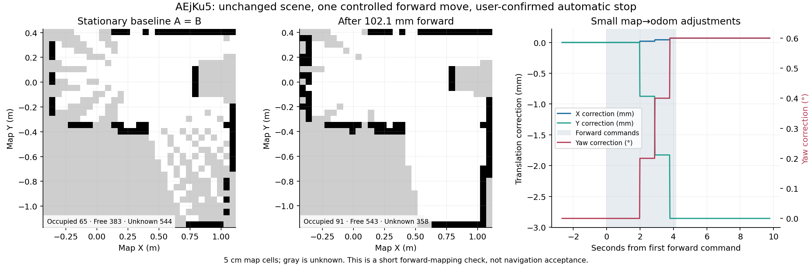

# Controlled forward mapping in the new scene — AEjKu5

2026-10-27, Asia/Seoul. This is the first clean stationary-to-moving map comparison
in the new physical scene. The user confirms that the commanded forward pulse was
the only robot movement from map startup through saving the after-map, that the
surroundings stayed unchanged, and that the robot moved and stopped completely on
its own without Ctrl+C or a motor-power cut. It supports a successful short forward
mapping trial; it does not establish full-route, turning, loop-closure, localization
or navigation performance.

## Session and runtime

- Mapping launch: `/home/turtle/jetson-map-newscene.nEKS7T`, started about 16:27 KST.
- Snapshots: `/home/turtle/jetson-map-baseline.f39hWE`, containing
  `baseline_a`, `baseline_b` and `after_forward` PGM/YAML pairs.
- Forward recording: `/home/turtle/jetson-mapping-motion.AEjKu5`, about 16:32 KST.
- Desktop retrieval: `/tmp/jetson-moving-map-AEjKu5`; offline C++ output in `review`.
- User checks: mapper active [3], input published 370 then 1,523 with rejected=1
  unchanged, fault=0, fresh=1. Before motion, `/cmd_vel` had zero publishers and
  one swerve_controller subscriber. The separate wheel launch remained running.

The accepted front mount and all existing profiles are unchanged. Input uses the
nominal timing model, zero hypothetical delay and acquisition_time_valid=0.
The startup stale-odometry warning is followed by fresh healthy output, without
sustained rejection growth. The known rounded minimum-range warning does not
justify changing the sensor profile. Read-only process inspection confirms this
new mapping launch replaced the old 700Cez session; no extra port owner was started.

## Baseline and map comparison

Baseline A and B have exactly identical PGM bytes and pixels. Their YAML geometry
and settings match; only the image filename differs. Both are 31x32 cells at 5 cm,
with origin [-0.432,-1.172,0] in the rounded saved YAML. The two saves completed
about 14.6 seconds apart. Their pixels also exactly match the first map in the
subsequent motion bag, confirming that the stationary map remained unchanged up
to the recorded trial baseline.

| Map | Occupied cells | Free cells | Unknown cells |
| --- | ---: | ---: | ---: |
| Both stationary baselines | 65 | 383 | 544 |
| After forward movement | 91 | 543 | 358 |

The after-map remains 31x32 cells, about 1.55x1.60 m, and its pixels exactly match
the final map recorded in the bag. Known cells increase from 448 to 634 as the
robot observes more of this small scene. This is occupancy evidence under the
current mapper settings, not a claim of collision-free or validated Nav2 space.

The exact grid origin shifts from (-0.432368502,-1.171993408) to
(-0.433193656,-1.173849158) m, about 2.03 mm total. The figure positions both grids
using their recorded world origins; cell-index differences alone are not a precise
registered change metric. Major occupied boundaries remain visually consistent,
and previously sparse free-space rays fill in after the movement.

## Motion, stopping and input evidence

The bag contains 2,310 messages across all seven expected topics: 636 odometry,
128 corrected scans, 13 input status, seven maps, 1,479 dynamic TF, two static TF,
and 45 commands. Deserialized odometry matches the runner CSV byte for byte.

| Measurement | Result |
| --- | ---: |
| Forward displacement from runner baseline | 102.077 mm |
| Lateral displacement | 0.220 mm |
| Net wheel-odometry yaw | 0.001329 rad, about 0.076° |
| Largest yaw departure over the recorded trajectory | about 0.084° |
| Forward / explicit-zero publications | 40 / 5 |
| First forward to first zero publication | 4.146 s |
| Maximum command interval | 105.423 ms |
| Maximum odometry gap | 30.008 ms |
| Maximum pose-derived translation speed | 0.02562 m/s |
| Last measurable pose change after first zero | 0.405 s |
| Final constant-pose span | 5.220 s |
| Corrected scans / reference stamps within command interval | 128 / 42 |
| Median corrected scan reference interval | 99.812 ms |

Recorded status advances from published=3185 to 3305, with rejected=1 unchanged,
fault=0 and fresh=1 throughout. The user's physical stop confirmation is independent
of the software result. The raw result.json retains physical_stop_confirmed=false,
because that file cannot establish the user's observation.

The initial stationary raw timing capture is also complete: 200 frames, overflow=0,
clock_bad=0. Strict provenance/clock replay passes with 68,718 selected returns;
median host period is 99.700 ms. This raw file sealed before movement. The later
motion bag records corrected outputs rather than new raw timing provenance, so
neither file establishes optical acquisition timing calibration.

## Scan consistency and map correction

The existing C++ reviewer was reused without changing thresholds. It applies the
accepted front mount and interpolated wheel odometry at each corrected scan's
estimated reference time. One initial scan predates the bag's first odometry sample
and is excluded from geometric analysis, without extrapolation. The other 127
scans contribute 35,953 finite endpoints. The full 128 scans remain in the bag.

The first 15 bracketed stationary scans produce 280 stable geometric points and
266 frozen segments. Correspondence support, spread, segment-length and association
gates are the same as the earlier gUGiCK analysis: 12/15 supporting observations,
20 mm training correspondence radius, 10 mm median spread, 2–80 mm segment length,
angular seed gap <=8 output bins, and 50 mm held-out association gate. Identical
output-bin identity is not required because sparse resampling shifts occupied bins.

| Phase | Scans | Matched / candidate endpoints | Median residual | RMS residual |
| --- | ---: | ---: | ---: | ---: |
| Stationary holdout | 12 | 3,377 / 3,395 | 0.720 mm | 4.829 mm |
| Motion plus transition margin | 51 | 13,971 / 14,453 | 1.954 mm | 8.773 mm |
| After stop | 49 | 12,776 / 13,864 | 4.024 mm | 10.972 mm |

These unsigned, association-gated distances are exploratory local repeatability
statistics, not absolute accuracy or timing-calibration results. No odometry, delay
or ICP fit was performed. Visibility and finite-segment coverage change with motion.

map->odom changes by (+0.070 mm,-2.857 mm,+0.010470 rad), about 2.858 mm and 0.600°.
There are three small changes; the largest translation step is 1.031 mm and each
yaw step is about 0.200°. The final correction stays constant through the post-stop
capture. Applying that final rigid correction to the same associated post-stop
points changes RMS from 10.972 to 10.889 mm, a small effect that does not establish
a calibration improvement. There is no repeat of the earlier approximately
25 cm / 14° correction associated with the intervening repositioning.

## Integrity and next validation

Jetson and desktop SHA-256 values match:

| File | SHA-256 |
| --- | --- |
| Both baseline PGM files | `aa9bb83252afd3b7ba9ab6a1ab1c2d8821621c5a953287bb8d33099fc81d022e` |
| After-forward PGM | `6be89d65bf2019a8246fe19bf1e5ba548b2443c0c17450a6ba2bbf9f0d8b2315` |
| Motion bag SQLite | `2b35de019b2ec834daf00292322a990089247062ed9bb73262c00d335114a150` |
| Stationary timing JSONL | `a55660484d343e0dda66791ebe4384e3ba449948efea305994e78f3998225d2a` |

Keep the current wheel and mapping launches and the robot's current placement.
This result removes the need for another map reset while the scene remains
unchanged. The next useful validation is a bounded heading change with simultaneous
recording in this same mapping session. The installed live-map runner currently
supports only forward pulses; the older rotation-capture coordinator opens the
front LiDAR port and must not run alongside this mapper. A mapping-compatible
rotation mode must be prepared and verified before that hardware step.

Do not infer readiness for a long route or Nav2 from this short trial. Preserve
the accepted LiDAR setup and assumed wheel calibration. All retrieval and analysis
were read-only SSH and local processing; the user executed the hardware commands.
