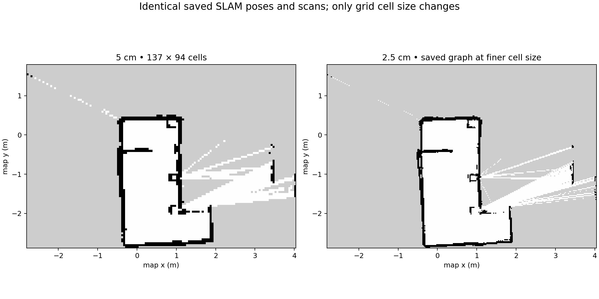
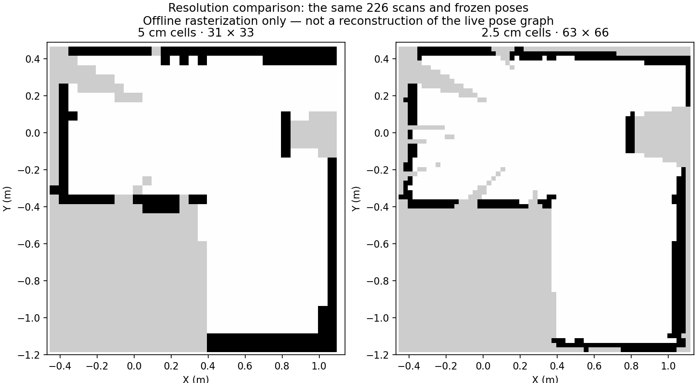

# 5 cm versus 2.5 cm grid comparison

## Current result — exact saved area graph

After G0I8Np, the user's xFPjny before/after graph and dataset archives were loaded
offline. The 5 cm render of each exactly matches its saved PGM pixels. This
supersedes the earlier frozen-odometry approximation for evaluating the area map.
The final graph contains 702 scans and 1,092 edges; both cell sizes use identical
optimized poses and min_pass_through=2 / occupancy_threshold=0.1, verified from
live parameters. No new scan matching, optimization or live configuration change
occurred. Archive load/render success does not validate live restart/relocalization.



| Grid | Dimensions | Cells | Occupied / free / unknown |
| --- | --- | ---: | --- |
| 5 cm | 137 x 94 | 12,878 | 548 / 2,634 / 9,696 |
| 2.5 cm | 274 x 187 | 51,238 | 1,467 / 10,022 / 39,749 |

Outputs: `/tmp/jetson-mapping-area-G0I8Np/graph-resolution/graph_5cm.{pgm,yaml}`
and `graph_2p5cm.{pgm,yaml}`. Finer boundaries do not improve the underlying pose
estimates or fill unobserved passages. See [area review](jetson_mapping_area_review.md)
for coverage, substantial map/odometry corrections and the limits of loop evidence.

```bash
source /opt/ros/lyrical/setup.bash
cmake -S tools/lidar_diagnostics/mapping_resolution -B /tmp/lidar-mapping-resolution-build
cmake --build /tmp/lidar-mapping-resolution-build -j2
/tmp/lidar-mapping-resolution-build/render_mapping_graph \
  /tmp/jetson-mapping-area-G0I8Np/jetson-area-checkpoints.xFPjny/after_graph \
  /tmp/area-graph-resolution-new-output 2 0.1
```

The renderer is local-only C++ and creates no ROS node. Both resolution targets
build with warnings as errors. Before/after pixel equality, final bag-map equality,
missing-input rejection and existing-output refusal were checked. The new output
directory must not already exist. Live NJWQJ7 remains at 5 cm; a live continuation
after deserialization has not yet been validated.

## Earlier comparison — caGdIe frozen odometry

2026-10-27. Both grids were rendered offline from the same 226 corrected scans in
caGdIe, with identical frozen poses, accepted sensor offset, NaN handling,
min_pass_through=2 and occupancy_threshold=0.1. No robot, mapper or sensor setting
was changed. Wheel calibration remains assumed and timing remains provisional.



| Grid | Dimensions | Cells | Occupied / free / unknown |
| --- | --- | ---: | --- |
| 5 cm | 31 x 33 | 1,023 | 125 / 571 / 327 |
| 2.5 cm | 63 x 66 | 4,158 | 360 / 2,343 / 1,455 |

Cell count rises about fourfold; dimension rounding accounts for the departure
from exactly four. Finer cells represent boundary shape more finely while also
revealing sparse/uneven evidence. This is a resolution comparison, not a measured
accuracy improvement or a reason to tune the sensor to match the sharper image.
Single-run desktop raster times were about 30 and 19 ms; their order/caching/noise
makes those unsuitable as a comparative benchmark or Jetson capacity estimate.

Important provenance: each scan's pose is interpolated from bracketed wheel
odometry, then transformed by the same final recorded map->odom transform. All
226 scans are bracketed. No scan matching or graph optimization is performed,
and the selected nodes of the NJWQJ7 graph are not reconstructed. Consequently
this 5 cm grid is not expected to equal the live 5 cm map. Changing resolution
is the only difference between these two offline grids. Both use the same
estimated corrected-scan origin contract already accepted for the experiment.

Source: `tools/lidar_diagnostics/compare_mapping_resolution.cpp`, built through
`mapping_resolution/CMakeLists.txt` with C++17 warnings as errors and the installed
Karto library. Data: `/tmp/jetson-route-caGdIe/resolution-comparison` (disposable).
Both PGM/YAML outputs and frozen_poses.csv are retained there.

```bash
source /opt/ros/lyrical/setup.bash
cmake -S tools/lidar_diagnostics/mapping_resolution -B /tmp/lidar-mapping-resolution-build
cmake --build /tmp/lidar-mapping-resolution-build -j2
/tmp/lidar-mapping-resolution-build/compare_mapping_resolution \
  /tmp/jetson-route-caGdIe/jetson-mapping-route.caGdIe/bag \
  /tmp/route-resolution-new-output
```

The exact saved-graph comparison is now completed above. Keep the live 5 cm
NJWQJ7 session; broad coverage is not blocked on the earlier 16.9 mm residual.

SLAM Toolbox 2.10.0 reads resolution_ in setParams during configuration and uses
it in updateMap; no set-parameter callback updates it in that implementation.
Do not assume a successful parameter-server write changes the current renderer.
Source: [version 2.10.0 implementation](https://github.com/SteveMacenski/slam_toolbox/blob/2.10.0/src/slam_toolbox_common.cpp).
The installed serialization helper writes .posegraph and .data; the user's live
serialize_map service was inspected read-only. Offline archive loading/rendering
has passed; live continuation after restoration and relocalization remain untested.
