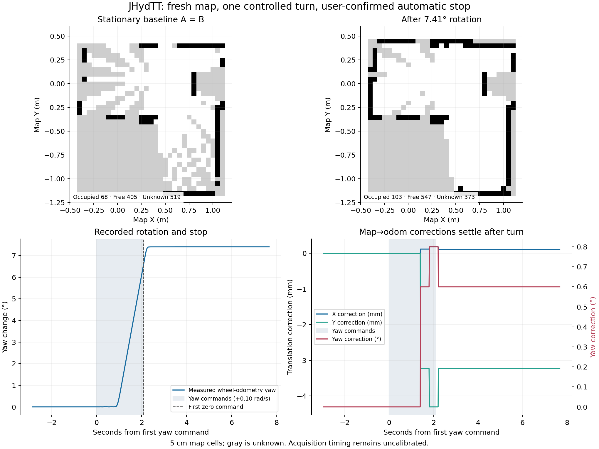

# Fresh-map rotation review — JHydTT

2026-10-27, Asia/Seoul. This controlled short rotation passes the motion/input
checks and supports continued bounded mapping trials. The user confirms smooth
rotation and a complete automatic stop without Ctrl+C or a motor-power cut. The
commanded turn was the only robot movement from map startup through the after-map,
and the surroundings stayed unchanged. Timing calibration, full-route mapping,
loop closure, relocalization and navigation are not established by this trial.

## Session and preserved runtime

- Map launch: `/home/turtle/jetson-map-rotation.NJWQJ7`, started about 16:58:53 KST.
- Baselines and after-map: `/home/turtle/jetson-map-rotation-snapshots.sIdcDI`.
- Motion recording: `/home/turtle/jetson-mapping-motion.JHydTT`, about 17:01 KST.
- Desktop retrieval and C++ review: `/tmp/jetson-rotation-map-JHydTT`, `review`.
- The user ran the verified v2 source bundle. Its installed source manifest passes.
  The accepted mount, driver, port, wheel configuration and zero plate X/Y/yaw
  are unchanged. Wheel odometry remains assumed calibrated; no fitting was done.

Read-only SSH confirms the same wheel launch PID 4948, new mapping launch 8963,
front input 8982 and mapper 8983. The old mapping launch is gone and the motion
runner has exited. Post-trial inspection reports active [3], published=2463,
rejected=4, fault=0, fresh=1, reason=publishing. There are zero `/cmd_vel` publishers
and one swerve_controller subscriber. Existing launches remain running.

Only the familiar startup stale-odometry and rounded minimum-range warnings appear
in the retrieved input/mapper logs. Neither warrants a profile change. Assistant
actions were read-only SSH and local analysis/documentation; user executed hardware.

## Stationary and after-map consistency

Baseline A/B PGM bytes are identical. Their YAML geometry/settings match except
for the image filename. The saves completed about 11.1 seconds apart. Baseline
pixels match the first map recorded in the motion bag, and after_rotation pixels
match the final recorded map. Thus all three snapshots are tied to this session;
the previous AEjKu5 scene is not used as this trial's reference.

| Snapshot | Dimensions | Occupied | Free | Unknown |
| --- | --- | ---: | ---: | ---: |
| Baseline A and B | 31x32 | 68 | 405 | 519 |
| After rotation | 31x33 | 103 | 547 | 373 |

Resolution stays 5 cm. Known cells increase from 473 to 650, with additional
boundary and free-space observations. Major occupied boundaries remain visually
consistent. This is a small occupancy snapshot, not a validated navigation map.

The exact origin changes from (-0.424490253,-1.179193953) to
(-0.424490253,-1.180804784) m: a 1.611 mm Y shift. The figure uses those exact bag
origins and common plotting limits. Because height and origin change, raw pixel
index differences are not an exact registered spatial-change metric.

## Rotation and stopping evidence

All seven streams are present: 527 odometry samples, 106 corrected scans, ten
status messages, six maps, 1,243 dynamic TF messages, two static TF messages and
25 commands (1,919 total). Deserialized odometry matches the runner CSV byte for
byte. The raw result retains physical_stop_confirmed=false; the user's later
physical confirmation is separate evidence and does not rewrite the capture.

| Measurement | Result |
| --- | ---: |
| Yaw commands / explicit zeros | 20 / 5 |
| Nonzero command | angular.z=+0.10 rad/s; all linear components zero |
| First yaw command to first zero | 2.081685 s |
| Maximum command interval | 106.423 ms |
| Net odometry yaw | 0.129264 rad / 7.4063° |
| Maximum translation from recording baseline | 0.0583 mm |
| Final forward / lateral displacement | +0.0357 / -0.0387 mm |
| Maximum odometry gap | 30.009 ms |
| Peak pose-derived yaw rate | 0.100892 rad/s |
| Corrected scans / stamps within command interval | 106 / 21 |
| Median corrected scan reference interval | 100.059 ms |

The smaller-than-nominal 11.5° turn is explained at the body-response level by
the recorded timeline: yaw rate first exceeds 0.005 rad/s about 0.853 seconds
after the first command, then reaches approximately the requested rate. This is
consistent with steering alignment taking part of the finite pulse, but the bag
does not record steering joints, so that cause is an inference. It is not a
measurement of LiDAR acquisition delay or evidence for changing wheel calibration.
The measured turn exceeds the preset +0.100 rad completion requirement; no pulse
extension or repeat is justified merely to reach the nominal angle.

About 0.01465 rad / 0.84° of measured rotation occurs after the first zero, during
deceleration. Yaw rate above 0.005 rad/s ends about 0.212 s after that zero. The
runner starts its five-second stationary post phase 0.606 s after the first zero.
Over that entire phase, yaw drifts by at most 0.0000381 rad and translation by
0.00594 mm. The last tiny measurable pose change is 1.392 s after the first zero;
the final exactly constant pose spans 4.200 s. This distinguishes the runner's
tolerance-based stationary window from exact numerical constancy. The user
independently confirms complete automatic physical stopping.

## Input, timing and fixed-scene analysis

Recorded status advances from published=1260 to 1350 with rejected=4 unchanged,
fault=0 and fresh=1 throughout. Nominal timing, zero hypothetical delay and
acquisition_time_valid=0 remain unchanged.

The initial raw timing file contains 200 complete frames, overflow=0, clock_bad=0.
Strict provenance/clock replay passes with 67,425 selected returns; median host
period is 99.606 ms (range 98.930–102.694 ms), with overlapping clock brackets.
It sealed before rotation. The motion bag contains corrected output rather than
new raw acquisition provenance; no optical timing calibration follows.

The unchanged geometric method analyzes 105/106 scans with 29,195 finite
endpoints. One initial scan predates the first recorded odometry sample and is
retained in the bag but excluded from geometry without extrapolation. The first
15 bracketed stationary scans form 283 stable points and 268 frozen segments.
Training support/radius/spread, segment and association gates remain unchanged
from the prior forward review; no ICP, pose, wheel or sensor-delay fitting occurs.

| Phase | Scans | Matched / candidate endpoints | Median residual | RMS residual |
| --- | ---: | ---: | ---: | ---: |
| Stationary holdout | 13 | 3,646 / 3,694 | 0.730 mm | 2.868 mm |
| Motion plus transition margin | 39 | 10,265 / 10,785 | 3.672 mm | 9.147 mm |
| After stop | 38 | 9,603 / 10,460 | 5.372 mm | 11.036 mm |

These unsigned, association-gated residuals describe local repeatability under
estimated scan reference times. Changing visibility and finite segments affect
them; they are not absolute accuracy measurements.

Final map->odom correction is (+0.106 mm,-3.233 mm,+0.010470 rad), about 3.235 mm
and 0.600°. It briefly reaches about 4.31 mm / 0.800° before returning to the final
value shortly after the first zero. It stays constant through the remaining
recording. Applying the final rigid correction to the same associated post-stop
points changes RMS from 11.036 to 10.955 mm (median 5.372 to 2.995 mm); this small
RMS change does not establish a timing or calibration improvement.

## Integrity and next step

Jetson and retrieved desktop hashes match:

| File | SHA-256 |
| --- | --- |
| Both baseline PGM files | `0f964444f744e123e7a09db36a8dec39eea0442d06de2b74eb79eeae291f66a8` |
| After-rotation PGM | `112357183836acf450aff6dedbe2af9cbe982f6b649a02e84193982ff90f910b` |
| Motion SQLite bag | `aa40afff5457a8d83aea0888caedc7eb03d944ef380dfaa76e8f18aa59c88638` |
| Stationary raw timing | `18c93d066b212f29938b7833a5f049b3c8f9a7c1cea5a32aa6f57484b05aa3c2` |

Preserve NJWQJ7, its current robot placement, continuous wheel odometry and mapper
runtime while the scene remains unchanged. No repeat rotation or reset is needed
for this result. The next useful controlled step is a short forward movement from
this new heading in the same mapping session, after checking forward clearance.
That tests translation following a turn without erasing map continuity. The v2
runner already supports the bounded forward mode; no new motion was executed or
scheduled by the assistant. Longer routes and Nav2 remain separate validation.
