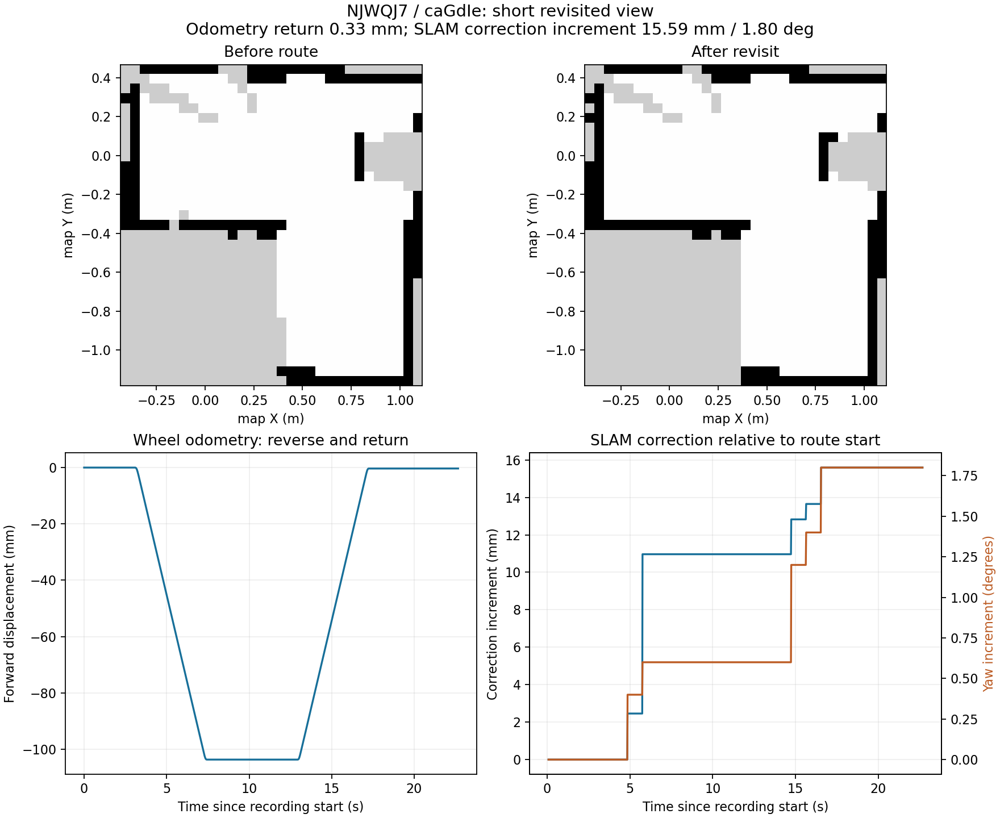

# Bounded reverse/return revisit — caGdIe

2026-10-27, about 17:55 KST. The caGdIe route completed in continuous mapping
session NJWQJ7. The user confirms both complete automatic stops without intervention,
manual repositioning or scene change. Motion, recording and input checks pass.
This demonstrates a bounded revisited view; fine scan consistency remains unresolved
and neither longer-route accuracy nor loop closure is established.

## Evidence and continuity

- Route: `/home/turtle/jetson-mapping-route.caGdIe`.
- Before/after saves: `/home/turtle/jetson-map-route-snapshots.UWhkln`.
- Mapper: `/home/turtle/jetson-map-rotation.NJWQJ7`; unchanged wheel/LiDAR settings,
  accepted wheel calibration assumption and zero plate offsets.
- Desktop retrieval: `/tmp/jetson-route-caGdIe`; accepted offline analysis:
  `review-v2` (the earlier `review` has an invalid post-phase classification).

User checksum verification and Jetson build succeeded. Before-route pixels match
IcK9xK/after_forward byte for byte; the user-run YAML comparison also passed.
Before/after saved pixels match the bag's first/last maps. Bag odometry deserializes
to exactly the runner's CSV. Initial map->odom equals the last gcQZct correction.
Together with unchanged-scene confirmation, these support session continuity;
there is no continuous bag covering the whole interval between trials.

SHA-256 verified between Jetson and desktop:

| Capture | SHA-256 |
| --- | --- |
| SQLite route bag | `213c98f43b20f0664c6fe4e5db04a075c0dd380345cf6fac23e0ce175ed8f62e` |
| Before PGM | `a7f3b1fd74efedb805a874fbe797abc17426ad64f61e980e88290765c75782f0` |
| After PGM | `52c26414533392b70c8611d58ffee657202138e1ebc3b043806534c1b665aa30` |

## Motion and stops

| Measurement | Result |
| --- | ---: |
| Reverse / return / zero commands | 40 / 40 / 10 |
| Reverse first command to first zero | 4.162600 s |
| Return first command to first zero | 4.154411 s |
| Largest command gap | 106.541 ms |
| Reverse stopped displacement | -103.680 mm |
| Final displacement relative to start | -0.331 mm forward, +0.0285 mm lateral |
| Final yaw difference | +0.05750 degrees |
| Maximum lateral departure | 0.140 mm |
| Peak pose-derived translation speed | 0.025522 m/s |
| Largest odometry gap | 20.133 ms |
| Corrected scans in reverse / return command intervals | 42 / 42 |

The 100 mm reverse target is a command-stop threshold, not an exact stopping
position: the stopped result is 103.68 mm backward, inside the 150 mm bound.
Return reaches the target-zero condition after 40 nonzero publications. No
extra pulse, retry or correction was issued. The stopped final position is within
the predefined 20 mm / 0.030 rad acceptance, but it is wheel odometry rather than
independent ground truth.

Both five-second stationary captures contain 250 odometry samples. They are not
bitwise constant: reverse-hold forward range is 0.00198 mm with yaw range
0.000674 degrees; final-hold forward range is 0.01385 mm with yaw range
0.004708 degrees. These are well within the runner's stop/hold bounds. Physical
stopping is independently confirmed by the user. Preserve the original
`physical_stop_confirmed=false` in result.json; do not rewrite raw captures.

This small odometry variation matters for analysis: the old exact-last-motion
heuristic classified all final scans as motion. Route review now uses the recorded
stationary-capture events, checks their ordering and duration, and separates
baseline, reverse, midpoint, return and revisit. It does not call tiny nonzero
odometry samples proof of continued physical motion.

## Input, coverage and scene consistency

All seven streams are present: 1,134 odometry, 226 corrected scans, 23 status,
13 map, 2,658 dynamic TF, two static TF and 90 command messages. All 226 scan
reference stamps have odometry brackets, including all motion and transitions;
no extrapolation or startup exclusion was needed. Status advances from
published=34035 to 34255 with rejected=4 unchanged, fault=0 and fresh=1.

The same fixed reference construction uses 15 baseline scans, 273 stable points
and 259 segments. No ICP, wheel calibration or timing fit was made. Association
and segment gates are unchanged from the prior review.

| Phase | Scans | Matched / candidate returns | Median residual | RMS residual |
| --- | ---: | ---: | ---: | ---: |
| Initial holdout | 13 | 3,614 / 3,660 | 0.718 mm | 2.973 mm |
| Reverse and stop transition | 50 | 13,226 / 14,038 | 3.384 mm | 9.447 mm |
| Midpoint hold | 48 | 11,717 / 13,437 | 8.164 mm | 13.442 mm |
| Return and stop transition | 51 | 13,441 / 14,287 | 10.351 mm | 15.829 mm |
| Revisited stationary view | 49 | 13,528 / 13,749 | 10.348 mm | 16.929 mm |

The revisit is not back at initial stationary repeatability, despite the very
small wheel-odometry return difference. Applying the final relative SLAM rigid
correction to the same associated revisit points gives RMS 17.925 mm, rather
than improving this particular metric. That calculation is not a timed TF replay
or an independent assessment of SLAM accuracy. The mismatch cannot presently be
assigned uniquely to physical pose error, sensor/timing behavior, association or
map scan matching. Keep wheel calibration assumed and acquisition timing marked
uncalibrated; do not tune either to force a passing number.

## Map and correction

The 31x33 grid remains at 5 cm resolution with the same exact bag origin
(-0.436251459,-1.183118228) m. Occupied/free/unknown cells change from
121/562/340 to 127/567/329. The coarse map retains its major boundaries without
an obvious new doubled wall; its cell size cannot establish millimetre consistency.

map->odom changes five times. The net route increment is
(+11.208,-10.839) mm and +0.031410 rad: magnitude 15.592 mm and 1.800 degrees.
Largest individual steps are 10.180 mm and 0.010470 rad (0.600 degrees), below
the predefined 50 mm / 0.050 rad screening flags. The final correction is stable
through the revisit hold. Cumulative correction from the NJWQJ7 origin is
22.363 mm / 3.199 degrees; neither value is measured ground-truth error.

Post-run read-only status is published=34926, rejected=4, fault=0, fresh=1.
No command publisher remains; the swerve subscriber remains. Continuous mapping
is preserved. No hardware or Git action was executed by the assistant.

## Assessment and next step

Accept caGdIe as a completed bounded reverse/return motion with a recorded revisited
view, healthy input and confirmed stops. Do not certify fine map consistency,
loop closure or navigation readiness from this result. Preserve NJWQJ7 and current
placement; no repeat or longer motion is prescribed. Before expanding travel,
inspect the revisit disagreement using stationary repeatability and spatially
resolved boundary comparisons under the existing assumptions. Do not reset the
map merely because the residual increased. Persistence and actual loop-closure
verification remain separate milestones.

The offline reviewer now accepts `--reverse-return`, requires the sibling
`events.csv`, checks the two finite command legs/dwell, rejects uncovered motion
scans and produces five phase metrics. Its C++17 warnings-as-errors build passed.
Regression on gcQZct produced 14 byte-identical CSV/PGM outputs; a route passed to
single-pulse mode and a fixture with a shortened stationary capture were correctly
rejected. The physical route used the previously tested, unchanged runner bundle.
