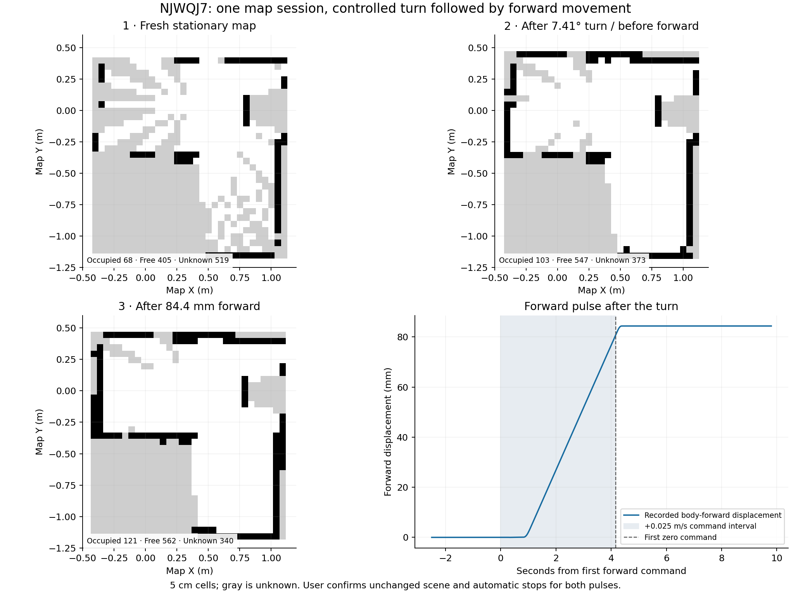

# Continuous turn-to-forward mapping review — gcQZct

2026-10-27, Asia/Seoul. gcQZct passes the bounded forward check following JHydTT's
turn in the same NJWQJ7 mapping session. The user confirms forward movement and
complete automatic stopping without intervention, with this pulse the only robot
movement since JHydTT and the scene unchanged. This establishes the initial short
turn-to-forward sequence; a longer route, revisited views, loop closure and Nav2
remain unvalidated. LiDAR settings, wheel calibration assumptions and timing
hypotheses are unchanged.

## Captures and continuity

- Continuing map: `/home/turtle/jetson-map-rotation.NJWQJ7`.
- Previous turn: `/home/turtle/jetson-mapping-motion.JHydTT`.
- Forward run: `/home/turtle/jetson-mapping-motion.gcQZct`, about 17:10 KST.
- Before/after snapshots: `/home/turtle/jetson-map-turn-forward.IcK9xK`.
- Desktop retrieval and C++ analysis: `/tmp/jetson-turn-forward-gcQZct`, `review`.

The before_forward PGM is byte-identical to
`jetson-map-rotation-snapshots.sIdcDI/after_rotation.pgm`; YAML settings/geometry
match apart from image filename. Before/after pixels match the first/final map
recorded in gcQZct. The last JHydTT odometry pose and map->odom transform exactly
match the corresponding first gcQZct values. These boundary checks and the user's
unchanged-scene confirmation support continuity across the approximately nine-minute
gap; the two finite bags do not continuously record that entire interval.

Read-only post-run inspection finds the same wheel PID 4948, map launch 8963,
front input 8982 and mapper 8983 still running; no motion runner remains.
Lifecycle is active [3], status published=7825, rejected=4, fault=0, fresh=1.
There are zero command publishers and one swerve_controller subscriber. Retrieved
logs contain only the familiar startup warnings, with no new mapper/input error.

## Forward motion and stopping

All seven expected streams are present: 616 odometry samples, 140 corrected scans,
14 status messages, eight maps, 1,536 dynamic TF messages, two static TF messages,
and 45 commands (2,361 total). Deserialized odometry matches the runner CSV byte
for byte. User stopping evidence remains separate from the raw result.json
physical_stop_confirmed=false field; the capture is not rewritten.

| Measurement | Result |
| --- | ---: |
| Forward / zero publications | 40 / 5 |
| First forward command to first zero | 4.166129 s |
| Maximum command interval | 105.813 ms |
| Body-forward travel | 84.389 mm |
| Net lateral travel | 0.044 mm |
| Net yaw | 0.0002005 rad / 0.01149° |
| Largest yaw departure | 0.0006256 rad / 0.03585° |
| Peak pose-derived translation speed | 0.025325 m/s |
| Maximum odometry gap | 20.198 ms |
| Corrected scans / stamps inside command interval | 140 / 42 |
| Final exactly constant pose | 5.360 s |

Forward speed first exceeds 0.005 m/s about 0.861 seconds after the first command,
then reaches the requested speed. This explains much of the difference from the
nominal 10 cm. Steering realignment after the turn is a plausible cause of the
delay, but steering joint states are not in this bag. It is not a measured LiDAR
delay and does not justify wheel recalibration, pulse extension or a retry.

Travel after the first zero is about 3.565 mm. Speed above 0.005 m/s ends about
0.174 s after that zero; the last measurable pose change is at +0.274 s. The
five-second post phase starts at +0.647 s and has exactly constant recorded pose.
The user independently confirms a complete automatic physical stop.

## Input and fixed-scene consistency

Recorded status advances from published=6622 to 6752 with rejected=4 unchanged,
fault=0 and fresh=1 throughout. Median scan-reference interval is 99.775 ms.
No new raw timing capture was made: NJWQJ7's validated initial raw file sealed
before either motion. The bag contains corrected outputs using nominal timing,
zero hypothetical delay and acquisition_time_valid=0.

The first 17 scan stamps precede the bag's first odometry sample during preflight.
They remain in the saved bag and are excluded from geometry without extrapolation.
Every scan ID 17 through 139 is bracketed: 123 scans and 34,373 finite endpoints.
This startup coverage limitation does not remove scans from the commanded interval.
The first 15 bracketed stationary scans form 270 stable points and 253 segments;
the same correspondence, spread, segment and association gates as before are used.
No ICP, wheel, pose or timing fit was performed.

| Phase | Scans | Matched / candidate endpoints | Median residual | RMS residual |
| --- | ---: | ---: | ---: | ---: |
| Stationary holdout | 9 | 2,421 / 2,484 | 0.689 mm | 4.627 mm |
| Motion plus transition margin | 49 | 13,172 / 13,731 | 2.597 mm | 9.560 mm |
| After stop | 50 | 13,049 / 14,039 | 4.811 mm | 11.508 mm |

These unsigned, association-gated statistics are exploratory local repeatability,
not absolute map accuracy or timing calibration. Applying the final relative SLAM
correction to the same associated post points changes RMS from 11.508 to 11.264 mm,
which does not establish a calibration improvement.

## Map evolution across both movements

| Stage | Cells | Occupied | Free | Unknown | Known |
| --- | --- | ---: | ---: | ---: | ---: |
| Fresh stationary map | 31x32 | 68 | 405 | 519 | 473 |
| After turn / before forward | 31x33 | 103 | 547 | 373 | 650 |
| After forward | 31x33 | 121 | 562 | 340 | 683 |

Resolution remains 5 cm. The final snapshot records additional boundary and free
space observations with visually consistent major boundaries. Unknown areas remain;
these counts are not collision-clearance or navigation acceptance.

During gcQZct the exact grid origin changes from (-0.424490253,-1.180804784) to
(-0.436251459,-1.183118228) m, about 12.0 mm total. Plots use these exact bag
origins; direct pixel-index differences are not precise registered changes.

map->odom changes by (+0.445 mm,-4.950 mm,+0.013960 rad) during this forward pulse:
4.970 mm and 0.800°. It updates twice and is stable after stopping. Across the
entire map session through the turn and forward pulse, the final correction is
(+0.551 mm,-8.183 mm,+0.024430 rad), magnitude 8.201 mm and 1.400°. Distinguish
this accumulated correction from the increment during the forward trial.

## Integrity and next validation

Jetson and desktop SHA-256 values match:

| File | SHA-256 |
| --- | --- |
| Before-forward PGM / prior after-rotation PGM | `112357183836acf450aff6dedbe2af9cbe982f6b649a02e84193982ff90f910b` |
| After-forward PGM | `a7f3b1fd74efedb805a874fbe797abc17426ad64f61e980e88290765c75782f0` |
| Motion SQLite bag | `00b87415c6effff8326f6cf5e90851a2f22fb343d1805617068072e8496242f7` |

Preserve NJWQJ7 and the current robot placement while the scene is unchanged.
There is no reason to repeat either completed pulse or reset the map. This is a
useful checkpoint: initial live mapping, a bounded turn and forward travel after
that turn now have controlled evidence within one map session.

The next validation should be a short bounded route that revisits a known view,
to assess accumulated drift and consistency over more than isolated pulses. Its
geometry and travel bounds must be chosen from available physical space before
issuing commands; no longer route has been prepared or executed. Keep the LiDAR
setup and wheel calibration assumptions intact.
All assistant retrieval was read-only SSH; hardware and Git remain user-operated.
