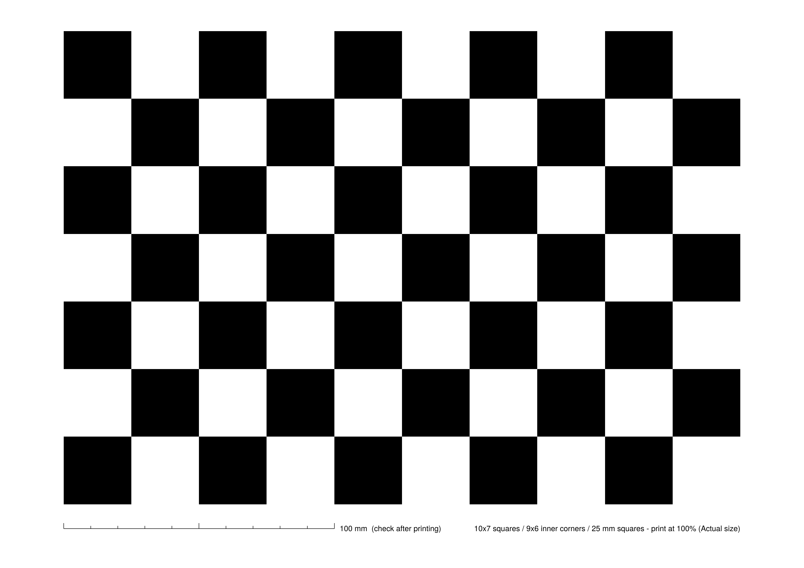

# 카메라 캘리브레이션 가이드 (Arducam 광각)

광각 카메라(Arducam UC-684)의 내부 파라미터(K)와 왜곡 계수(D)를 구하는 절차와 결과를 정리한 문서. [YOLO26 가이드](yolo26_isaac_sim_guide.md) 11.3절을 실제로 진행하면서 정한 방법이다.

- 결과 파일: [`config/camera_wide.yaml`](../../config/camera_wide.yaml)
- 체커보드: [`assets/checkerboard_9x6_25mm.png`](assets/checkerboard_9x6_25mm.png) (300dpi 이미지)

> D435(손목)는 공장 intrinsics를 쓰므로 이 절차가 필요 없다. YOLO26 가이드 11.3절의 `camera_info` 확인만 하면 된다.

---

## 1. 체커보드



| 항목 | 값 |
|---|---|
| 칸 수 | 10 × 7 (**내부 코너 9 × 6**) |
| 칸 크기 | **25 mm** |
| 용지 | A4 가로 |
| 확인용 눈금 | 보드 아래 100 mm 눈금자 |

### 1.1 인쇄해서 쓰는 경우

1. PDF를 **실제 크기(100%)**로 인쇄한다. "용지에 맞춤"을 고르면 칸 크기가 바뀐다.
2. 아래 100 mm 눈금을 자로 재서 맞는지 확인한다.
3. **칸 8개 길이를 캘리퍼스로 재서 8로 나눈 값**을 실제 칸 크기로 쓴다.
4. 폼보드·아크릴처럼 휘지 않는 판에 평평하게 붙인다. 무광 용지가 좋다.

### 1.2 모니터에 띄워서 쓰는 경우 (2026-10-20 측정은 이 방법)

프린터가 없을 때 쓴다. 모니터 화면은 인쇄물보다 평평해서 결과가 오히려 좋다.

1. PDF(또는 PNG)를 모니터에 띄우고, 확대 비율을 조절해서 **화면 위 칸 한 변이 25 mm**가 되게 맞춘다. 칸 8개를 자로 재서 200 mm가 되면 된다.
2. 맞춘 뒤에는 확대 비율을 건드리지 않는다.
3. 모니터는 고정하고 **카메라를 움직이며** 찍는다.
4. 흰 칸에 물결무늬(모아레)가 심하면 모니터 밝기를 낮추거나 카메라를 조금 떨어뜨린다.

---

## 2. 촬영

### 2.1 캡처 조건

- 실제로 쓸 모드 그대로: **MJPG 1280×720** (`/dev/video8`, 장치 번호는 바뀔 수 있음)
- 화면 캡처가 아니라 **카메라 원본 프레임**을 저장한다. 창 캡처는 크기가 달라서 쓸 수 없다.
- 노출·화이트밸런스는 자동이어도 된다. 캘리브레이션은 기하만 재므로 색·밝기와 무관하다. 흔들림만 없으면 된다.
- 같은 카메라를 다른 프로그램(ffplay, guvcview)이 열고 있으면 `Device or resource busy`가 난다. 먼저 끈다.

### 2.2 어떤 사진이 필요한가

| 조건 | 이유 |
|---|---|
| 한 장에 **코너 54개가 모두** 보일 것 | 일부라도 잘리면 그 사진은 검출 실패로 버려진다 |
| 보드가 화면 **네 모서리와 좌우 끝**까지 오게 | 왜곡이 가장 큰 곳. 여기 데이터가 없으면 값이 틀어진다 (3.3 참고) |
| 좌우·위아래로 **30~45° 기울인** 사진 | 초점거리와 왜곡을 분리하는 데 필요 |
| 가까운 거리 ~ 먼 거리 | 크기 변화 |
| 흔들리지 않은 사진 | 자세마다 2~3초 멈춘다 |

목표는 **25장 이상, 코너 검출 100%**.

### 2.3 방법 A: 안내형 촬영 프로그램 (권장)

[`tools/camera_calib/cam_calib.cpp`](../../tools/camera_calib/cam_calib.cpp) (C++/OpenCV). 화면을 3×3 칸으로 나눠 아직 안 찍은 곳(빨강)과 기울기 체크리스트를 보여 주고, 보드가 다 보이고·멈춰 있고·이전 사진과 다르면 자동으로 저장한다.

```bash
sudo apt install libopencv-dev          # 처음 한 번
mkdir -p build && g++ -O2 -std=c++17 tools/camera_calib/cam_calib.cpp -o build/cam_calib $(pkg-config --cflags --libs opencv4)
./build/cam_calib --dev /dev/video8 --out ~/calib_wide2
```

- 3×3 칸이 모두 초록, TILT 4개가 모두 `[x]`, 25장 이상이면 `DONE`이 뜬다. `q`로 종료, `s`로 강제 저장.

### 2.4 방법 B: ffmpeg로 1초에 한 장 (도구 없이)

미리보기를 보면서 1초에 한 장씩 원본을 저장한다. Ubuntu 24.04(Wayland)에서는 ffmpeg의 SDL 창이 안 뜨므로 ffplay로 넘겨서 본다.

```bash
mkdir -p ~/calib_wide && cd ~/calib_wide
ffmpeg -f v4l2 -input_format mjpeg -video_size 1280x720 -framerate 30 -i /dev/video8 \
  -vf fps=1 -q:v 2 frame_%03d.jpg \
  -c:v copy -f mjpeg - | ffplay -f mjpeg -fflags nobuffer -window_title preview -
```

- 멈출 때는 **터미널에서** `Ctrl+C`.
- 안내가 없어서 모서리가 빠지기 쉽다. 2026-10-20 1차 촬영(67장)은 이 방법으로 29장만 검출됐고 모서리가 비었다.

사진은 **레포에 커밋하지 않는다** (팀 공유 드라이브에 보관).

---

## 3. 계산

### 3.1 방법

OpenCV fisheye 모델(`cv2.fisheye.calibrate`)을 쓴다.

| 설정 | 값 |
|---|---|
| 코너 검출 | `findChessboardCornersSB` (실패 시 `findChessboardCorners` + `cornerSubPix`) |
| flags | `CALIB_RECOMPUTE_EXTRINSIC`, `CALIB_FIX_SKEW`, `CALIB_CHECK_COND` |
| 이상치 제거 | 사진별 재투영 오차가 **1 px**를 넘는 사진을 하나씩 빼고 다시 계산 (15장 이상 남을 때까지) |
| 합격 기준 | 전체 **RMS 0.5 px 이하** |

- OpenCV **4.x**를 쓴다. OpenCV 5.0은 `cv2.fisheye.CALIB_*` 상수 이름이 바뀌어서 그대로는 안 돌아간다.

### 3.2 확인

1. **RMS**: 0.5 px 이하
2. **커버리지 그림**: 검출된 코너를 한 그림에 모두 찍어서 화면 모서리까지 채워졌는지 본다
3. **보정 화면**: `cv2.fisheye.initUndistortRectifyMap`으로 편 영상에서 체커보드 줄이 곧은지 본다
4. **두 번 이상 측정해서 K가 일치하는지** 본다 (아래 3.3)

### 3.3 주의: 모서리가 비면 값이 틀린다

2026-10-20에 실제로 겪은 일.

| 데이터 | 사용 장수 | RMS | fx / fy | 수평 / 수직 FOV |
|---|---|---|---|---|
| 1차만 (ffmpeg, 모서리 비어 있음) | 19 | 0.54 px | 676 / 675 | 108° / 61° |
| 2차만 (안내형 프로그램) | 22 | 0.31 px | 855.7 / 855.0 | 94° / 49° |
| **1차 + 2차 (채택)** | **41** | **0.45 px** | **853.4 / 852.2** | **94° / 50°** |

1차만 쓴 값은 RMS가 0.54 px로 기준에 가까웠지만 **fx가 20% 넘게 틀렸다.** fisheye 모델은 초점거리와 왜곡 계수가 서로 보상할 수 있어서, 모서리 데이터가 없으면 RMS가 낮아도 엉뚱한 값으로 수렴한다. RMS만 보지 말고 커버리지와 반복 측정 일치를 같이 확인해야 한다.

---

## 4. 결과 (2026-10-20, 채택값)

| 항목 | 값 |
|---|---|
| 해상도 | 1280 × 720 (MJPG) |
| 모델 | OpenCV fisheye (ROS `equidistant`) |
| K | fx 853.374, fy 852.157, cx 675.548, cy 371.440 |
| D (k1~k4) | −0.128704, 0.012667, −0.039807, 0.022852 |
| RMS | 0.45 px (41장) |
| 화각 | 수평 약 94°, 수직 약 50° |

저장 위치: [`config/camera_wide.yaml`](../../config/camera_wide.yaml) (ROS `camera_info` 형식이라 카메라 노드가 그대로 읽을 수 있다).

### 다른 문서·코드에 미치는 영향

- **YOLO26 가이드 3.4절**은 수평 FOV 120°(pinhole)를 가정해서 1.2 m에서 퍽이 약 9 px라고 계산했다. 실측값으로는 화면 중앙 기준 **1.2 m에서 약 21 px, 1.8 m에서 약 14 px**(≈ fx × 0.03 / 거리)다. 가장자리에서는 더 작다.
- **`yolo/dataset_gen/generate.py`**의 `CAMERA_PROFILES["wide"]`는 pinhole HFOV 100° 임시값이다. Isaac Sim fisheye 카메라로 바꿀 때 위 K, D를 넣는다.

### 다시 측정해야 하는 경우

- 렌즈를 돌리거나(초점 링) 카메라를 분해했을 때
- 캡처 해상도를 바꿨을 때 (해상도마다 K가 다르다)
- 다른 Arducam 개체로 바꿨을 때
