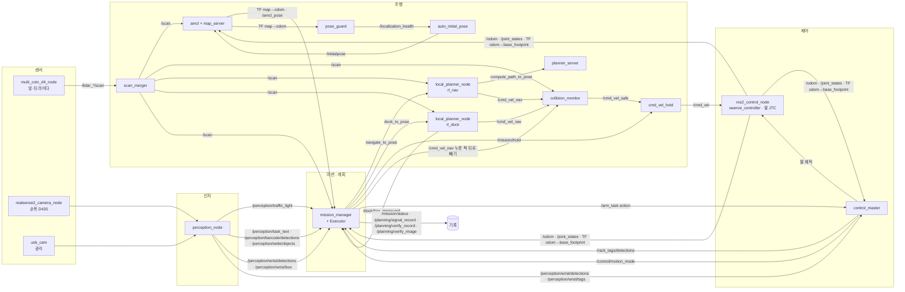
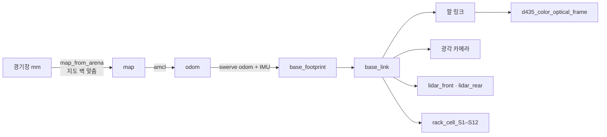
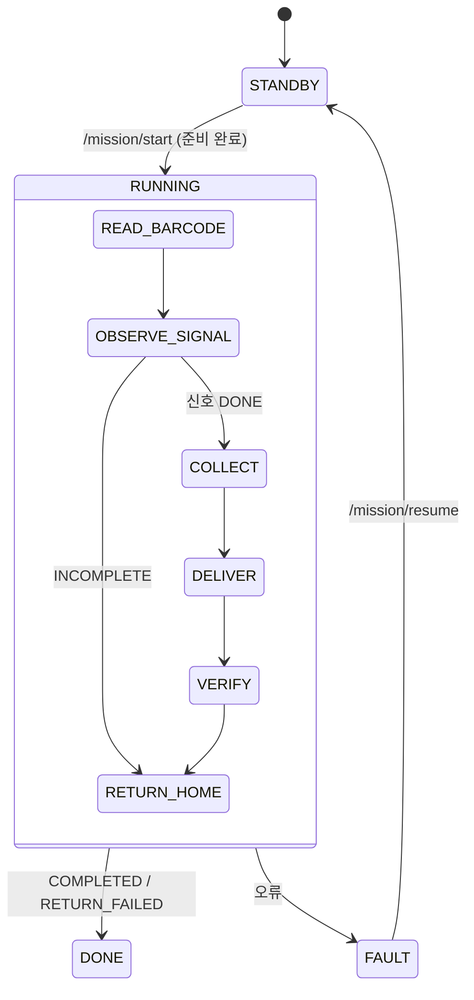

# 시스템 설계 (architecture)

- 기준: 1 회차 경기 run 에서 실제로 띄운 구성 (`bringup/launch/mission_system.launch.py`)
- `mission_manager` 노드 하나가 전체 단계를 순서대로 실행함
- 로봇은 바코드를 먼저 읽고, 출발 자리로 돌아가 신호를 기록함
- 위치 추정 = AMCL (`localization:=amcl`) → 이 run 에서 slam_toolbox 는 안 띄움 (지도 arena7 은 미리 slam_toolbox 로 만든 것)

## 1. 하드웨어

| 구성 | 내용 |
|---|---|
| 구동 | 4 륜 스워브 (바퀴마다 조향 · 구동 모터), 연속 조향, 최고 0.255 m/s |
| 팔 | 4 관절 + 손목 회전, 그리퍼 |
| 적재함 | 12 칸 (S1–S12), 칸마다 바닥 AprilTag |
| 센서 | LDS-03 × 2 (앞 · 뒤, 바닥 60 mm), 손목 RealSense D435 (컬러 · 깊이), 광각 UC-684 (아래 40°), IMU |
| 컴퓨터 | Jetson Orin Nano 8 GB (모든 노드), OpenCR × 2 (바퀴 · 팔 모터 통신) |

## 2. 노드 · 토픽

| 이름 | 타입 | 보내는 쪽 → 받는 쪽 | 내용 |
|---|---|---|---|
| `/perception/traffic_light` | `interfaces/TrafficLight` | perception → mission | UNKNOWN · RED · YELLOW · GREEN · OFF + visible, 약 23 Hz |
| `/perception/task_text` | `interfaces/TaskText` | perception → mission | 바코드 원문 (판독 결과) |
| `/perception/barcode/detections` | `interfaces/DetectionArray` | perception → mission | 손목 영상 속 바코드 상자 (다시 겨누기용) |
| `/perception/wide/objects` | `interfaces/DetectionArray` | perception → mission | 광각 검출 상자 (바코드 판 찾기) |
| `/perception/wrist/detections` | `interfaces/DetectionArray` | perception → planning · control | 퍽 색 · 모양 · AprilTag ID · 3D 자세 (촬영 시각 stamp) |
| `/perception/wrist/box` | `interfaces/DetectionArray` | perception → mission | 장소 박스 윗면 중심 · 각도 |
| `/perception/wrist/tags` | `interfaces/WristTagArray` | perception → control | 적재함 · 쥔 퍽 태그 |
| `/rack_tags/detections` | `interfaces/DetectionArray` | control → mission | 적재함 칸 · 칸 안 퍽 (빈손일 때 재고 다시 맞추기) |
| `/arm_task` | `interfaces/action/ArmTask` | planning → control | HOME · PICK · PLACE · STORE · RETRIEVE · LOOK · LOOK_BARCODE · LOOK_AT · LOOK_RACK, 목표점 · 칸 · 퍽 ID |
| `/control/motion_mode` | `interfaces/MotionMode` | control → planning | STOP · DRIVE · ARM + ready |
| `navigate_to_pose` · `dock_to_pose` | `nav2_msgs/action/NavigateToPose` | planning → navigation | 주행 · 정밀 접근 |
| `/amcl_pose` | `geometry_msgs/PoseWithCovarianceStamped` | amcl → planning | 위치 추정 상태 판단 (공분산) |
| `/dock/box_measured` | `geometry_msgs/PoseStamped` | rl_dock → planning | 라이다로 잰 박스 정차점 |
| `/mission/status` | `interfaces/MissionStatus` | mission → 기록 | 상태 · 단계 · 퍽 수 · 경과 시간 |
| `/planning/signal_record` · `/planning/verify_record` | `interfaces/SignalRecord` · `VerifyRecord` | mission → 기록 | 신호 · 재검증 결과 |
| `/mission/cargo` | `interfaces/CargoState` | planning → 기록 | 적재함 · 그리퍼 재고 |

## 3. 좌표계

- 경기장 → map 변환 = `map_from_arena`
	- 값 (x, y, yaw) = (0.3945 m, 0.9310 m, 178.9°)
	- arena7 지도 벽에 도면을 맞춰 구함
	- 설정 파일: `results/config/dice_map_arena7b.yaml`
- 검출 → map: 촬영 시각 TF 로 변환 (손목 카메라는 팔과 함께 움직임)
- 팔 목표: map 점을 base_link 로 바꿔 `/arm_task` 에 넣음
- 놓기 높이: 박스 윗면 70 mm + 퍽 반 높이 + 쥐는 위치
- 정차: 박스 중심에서 0.2575 m 앞 (차체 앞 끝 ↔ 박스 면 약 1 cm)

## 4. 실행 순서 · 단계 완료 조건

| 단계             | 하는 일                                               | 완료 조건                        | 실패 처리                                                     |
| -------------- | -------------------------------------------------- | ---------------------------- | --------------------------------------------------------- |
| STANDBY        | 준비 확인 (모드 · 라이다 · 검출 · 위치 · Nav2 · 팔 서버 · 카메라 서비스) | 준비 이유 0 개 + `/mission/start` | 시작 거절                                                     |
| READ_BARCODE   | 벽 판 찾기 → 손목 겨눔 → 판독 → HOME                         | 표에 있는 문자열                    | 미등록 = FAULT `BARCODE_UNREGISTERED`, 벽 판 못 찾으면 고정 자세로 판독   |
| OBSERVE_SIGNAL | 출발 자리에서 12 점멸 기록                                   | DONE (12 개 · 횟수 규칙 · 끝 소등)   | INCOMPLETE = 수집 안 하고 출발 자리로 복귀 (다시 기록 `signal_retries` 0) |
| COLLECT        | 박스마다 이동 → LOOK → PICK → STORE                      | 계획한 퍽 모두 적재                  | 재시도 → 재고 정합 → 재계획                                         |
| DELIVER        | 장소마다 이동 → 박스 측정 → RETRIEVE → PLACE                 | 칸마다 PLACE 성공                 | 재시도 → 부분 채우기 재계획                                          |
| VERIFY         | 장소마다 새 LOOK → 칸 · ID · 색 · 모양 · 개수 판정              | 세 곳 판정 기록 (`verify.yaml`)    | 판정 FAIL 도 기록만 하고 진행                                       |
| RETURN_HOME    | 출발 자리로 이동                                          | 도착 → DONE COMPLETED          | RETURN_FAILED                                             |

- 수집 순서: B1 → B2 → B4 → B5 → B6 → B3
- 배달 순서: L3 → L2 → L1
- 재검증 순서: L1 → L2 → L3
- 이동은 두 단계: Nav2 목표 (정차점 뒤 2.5 cm) → 정차점 0.40 m 안에서 정밀 접근 (`dock_to_pose`)
- 팔 작업 전 바퀴 STOP → ARM, 팔 작업 뒤 HOME 접힘 확인 → DRIVE

## 5. 상태도 · 안전 정지

| 오류            | 감지                                              | 동작                                                                             |
| ------------- | ----------------------------------------------- | ------------------------------------------------------------------------------ |
| 미등록 바코드       | 바코드 표에 없음                                       | FAULT, 움직이지 않음                                                                 |
| 신호 누락 · 불명    | 12 개 아님 · 횟수 규칙 위반 · 못 봄 ≥ 0.8 s                | INCOMPLETE → 수집 안 함                                                            |
| 제어 · odom 끊김 | `/control/motion_mode` · `/odom` 1 s 넘게 안 옴 | 바로 FAULT `CONTROL_LOST` · `ODOM_LOST` |
| 주행 모드 아님 | MotionMode 가 DRIVE 아님 (대기 원인 `DRIVE_LOST`) | 이동 막음 + `/mission/hold`, 10 s 넘으면 HOME 끼움, 그래도 안 되면 FAULT `DRIVE_NOT_RESTORED` |
| 라이다 끊김 | 앞 · 뒤 라이다 중 하나라도 끊김 (`SCAN_LOST`) | 이동 막음 + `/mission/hold`, 10 s 안에 안 돌아오면 FAULT |
| 검출 끊김 | 손목 검출 출력 끊김 (`DETECTION_LOST`, 주행 중 일부러 끈 동안은 안 셈) | PICK · LOOK 만 막음 (주행은 허용), 45 s 안에 안 돌아오면 FAULT |
| 위치 추정 상실 | AMCL 공분산 · 상태 (`LOCALIZATION_LOST`) | 이동 · PICK · PLACE 막음 + `/mission/hold` → 기다림 → 마지막 정상 자리로 물러남 → 돌아오면 계속 (`loc_recovery`) |
| 재고 불확실 | 팔 결과 · 그리퍼 실측이 재고 기록과 안 맞음 | 자동 재고 정합 (적재함 · 장소 다시 보기), 그래도 안 맞으면 FAULT `INVENTORY_UNCERTAIN` |
| 팔 HOME 실패     | HOME 거절 · 시간 초과                                 | FAULT `HOME_FAILED`                                                            |
| 퍽 쥔 채 주행      | 그리퍼 기록에 퍽 있음 + 이동 단계                            | FAULT `CARRY_DRIVE`                                                            |
| 장애물           | collision_monitor PolygonStop (몸 ±0.18 m)       | 바퀴 정지, 8 s 넘으면 이동 실패 → 재시도                                                     |
| mission 노드 정지 | `cmd_vel_hold` 가 `/mission/hold` 2.5 s 못 받음     | 바퀴 정지                                                                          |

- 감시 FAULT 는 팔 작업 중 · 퍽 쥔 동안이면 그 작업 정리 뒤로 미룸 (최대 60 s)
- FAULT 뒤에는 `/mission/resume` 전까지 움직이지 않음 (경기 규칙상 같은 회차 재개 안 함)
