# 프로젝트 2 - 주사위 기억 로봇 (Turtle Ninja)

- 기준 회차: 1 회차

---

## 1. 시스템 구성

### 1-1. 하드웨어 · 소프트웨어

**하드웨어**
- 4 륜 스워브 (연속 조향, 최고 0.255 m/s)
- 4 관절 + 손목 회전 팔, 그리퍼, 적재함 12 칸 (S1–S12)
- 라이다 LDS-03 × 2, 손목 RealSense D435, 광각 UC-684 (아래 40°)
- Jetson Orin Nano 8 GB, OpenCR × 2 (바퀴 · 팔)

**소프트웨어**
- JetPack 7.2.1 · Ubuntu 24.04 · ROS 2 Lyrical · TensorRT
- 인지 모델 (Jetson `~/models/`)

| 모델 | 파일 | 입력 | 클래스 |
|---|---|---|---|
| 광각 YOLO | `best_wide.engine` | 960 × 544 | red_cyl · green_cyl · red_box · green_box · barcode · traffic_light |
| 손목 YOLO26-seg | `best_wrist.engine` | 640 × 480 | 색 2 × 모양 2 × 서 있음/누움 = 8 |

→ 노드 · 토픽 · 좌표계 · 상태도: [`docs/architecture.md`](docs/architecture.md)

---

### 1-2. 실행 방법

**실행 명령 (Jetson)**
```bash
$ DRIVE_PORT=/dev/ttyACM0 ARM_PORT=/dev/ttyACM1 \
  bash tools/jetson/run_robot.sh mission opencr ~/maps/arena7 \
  dice_map:=$HOME/maps/dice_map_arena7b.yaml planning_params:=$HOME/planning_full.yaml \
  dds_transport:=DEFAULT dock:=rl rack_tags:=true localization:=amcl \
  initial_pose:=-0.357,-0.005,-1.1 mission_loc:=amcl \
  nav_policy:=nav_nf5 dock_policy:=dock3 dock_tol:=0.015 dock_search:=0.30
```

**시작 명령**
- `STANDBY 준비 완료` 뒤 신호 시작과 함께 실행
```bash
$ ros2 service call /mission/start std_srvs/srv/Trigger '{}'
```

**실행 설정**

| 항목 | 값 |
|---|---|
| 지도 | arena7 (slam_toolbox 로 매핑) |
| 위치 추정 | AMCL |
| 지역 주행 · 정밀 접근 | RL 정책 nav_nf5 · dock3 (도착 허용 1.5 cm) |
| 미션 설정 | `planning_full.yaml` · `dice_map_arena7b.yaml` |
| ROS 도메인 | 17 |

→ 실행 기록: [`results/logs/wrapper.log`](results/logs/wrapper.log), 설정 사본: [`results/config/`](results/config/)

---

### 1-3. 파트별 동작

| 파트  | 기능           | 방법                                                                                                                            |
| --- | ------------ | ----------------------------------------------------------------------------------------------------------------------------- |
| 인지  | 신호등 색        | 광각 YOLO 로 신호등을 찾고 칸별 흰색 비율 · 밝기로 색 판정 (자동 노출로 꺼진 렌즈도 포화되어 흰색 비율 먼저)                                              |
|     | 점멸 기록        | 켜짐 · 소등 경계로 셈 (켜짐 0.3 s 미만 버림), 소등 2.5 s 이어지면 끝, 애매한 색은 `?` (추정 안 함)                                                          |
|     | 바코드          | 광각으로 벽 판을 찾고 손목 카메라를 0.15 m 앞까지 겨눠 Code128 판독                                                                                 |
|     | 퍽            | 손목 YOLO26-seg 마스크 + 깊이로 색 · 모양 · 서 있음/누움 · 3D 중심 · 긴축, AprilTag 로 ID                                                          |
|     | 장소 박스        | 손목 깊이로 윗면 중심 · 각도를 재서 놓을 칸 보정                                                                                                 |
| 계획  | 할당 · 순서      | 상태 탐색 (Dijkstra) 으로 할당과 이동 순서를 함께 정함                                                                                          |
|     | 수집           | 퍽 12 개를 모두 실음, 집은 퍽은 바로 적재함에 넣고 쥔 채 주행 안 함                                                                                    |
|     | 퍽 ID 할당      | 배달 전 실은 퍽의 실제 색 · 모양으로 확정, Y 모양은 원기둥 · 사각기둥 둘 다 풀어 R · G 가 채워지는 해 중 시간이 짧은 쪽                                                  |
|     | 실패 처리        | 재시도 → HOME 끼우기 → 재계획                                                                                                          |
|     | 재검증          | VERIFY 단계의 새 관측만 씀                                                                                                            |
| 주행  | 경로 · 주행      | 전역 경로 = Nav2 planner, 지역 주행 = RL 정책                                                                                           |
|     | 정밀 접근        | 박스 앞 마지막 0.4 m 는 RL 정밀 접근 + 라이다 박스 면 추적, 정차 = 박스 중심에서 0.2575 m (차체 ↔ 박스 면 약 1 cm)                                             |
|     | 정차점 보정       | 잰 박스 정차점을 보정표에 남겨 재시도 · 재방문에 씀                                                                                                |
| 조작  | 작업 순서        | PICK → STORE (적재함) → RETRIEVE → PLACE, 바퀴와 팔은 차례로만 움직임 (팔 작업 뒤 HOME 접힘 확인 → 주행)                                               |
|     | 집기 · 놓기      | IK (Levenberg–Marquardt, 관절 한계 안), 수직 손으로 퍽 위 40 → 10 mm 를 거쳐 쥐는 높이까지, J2–J4 중력 처짐 앞먹임 보정 (`manipulation/arm_kinematics.hpp`) |
|     | 적재함 넣기 · 꺼내기 | 실물에서 충돌 · 도달을 검사한 경유점 경로 (`config/arm_paths.yaml`) 재생, 12 칸 모두 1 회차에서 성공 (2-6)                                                |
|     | 쥠 판정         | 그리퍼 손가락 사이 거리로 쥠 · 빈손 판정                                                                                                      |

---

## 2. 경기 결과 (1 회차)

### 2-1. 항목별 결과

**경기 조건**
- 신호 `RGGYYGGYRRRY` (R 4 · Y 4 · G 4), 바코드 `P2-02` (내림차순)
- 세 색 횟수가 같아 동률 규칙 R → Y → G 적용 → L1 = R4 · L2 = Y4 · L3 = G4
- 로봇은 Y 를 원기둥으로 정함 (원기둥 · 사각기둥 둘 다 가능, 이동 시간이 짧은 쪽)

**결과**

| 항목         | 결과                           | 근거        |
| ---------- | ---------------------------- | --------- |
| 신호 순서 기억   | 12 점멸 순서 일치                  | 2-4       |
| 색상별 횟수     | R 4 · Y 4 · G 4 일치           | 2-4       |
| 바코드 해석     | `P2-02` · 내림차순               | 2-3       |
| 장소 그룹 배정   | L1 R4 · L2 Y4 · L3 G4        | 2-1 경기 조건 |
| 색상 · 모양 선택 | 세 장소 수량 · 색 · 모양 조건 충족       | 2-7       |
| 주사위 눈 배치   | 세 장소 4 칸 모두 놓음, 칸 오차 2–16 mm | 2-7       |
| 이동 후 재검증   | 세 장소 ID · 위치 기록, 중복 · 누락 0   | 2-7       |
| 복귀         | 출발 중심 4.3 cm, 70 s 넘게 정지     | 2-5       |

- 로봇 기록: COMPLETED, 퍽 12 / 12
- 자율 주행하며 task를 수행했으나 퍽 적재 및 미션 수행과정에서 사람 개입 5번 있었음
- 위치 기준
	- 놓아야 할 위치 (눈 칸) 기준 ±5 cm 로 판정함 (경기 운영 기준)
	- 발제 문구 10 mm 기준이면 12 개 중 4 개 (11 · 11 · 11 · 16 mm) 가 넘음
- 경기 영상 (GIF 원본, 휴대폰 촬영)
	- 녹화는 미션 시작 약 17 s 뒤부터 (바코드 판독 장면 없음), 영상 시각 = 미션 시각 − 16.8 s
	- 아래 GIF 는 이 영상에서 자름 (원래 속도, 가로 400 px)

**퍽 할당 검증** ([`results/allocation.json`](results/allocation.json))
- 시점: 그룹 (L1 R4 · L2 Y4 · L3 G4) = 신호 기록 직후 (43 s), 퍽 ID 할당 = 배달 시작 · 첫 PLACE 전 (484 s)
- Y 모양: 원기둥 · 사각기둥 모두 가능 (원기둥 6 · 사각기둥 6), 이동 시간이 짧은 원기둥 선택

| 놓을 장소 (그룹) | 퍽 ID | 색   | 모양   | 칸 (로봇 기준) | 놓을 좌표 (경기장 mm) | 조건  |
| ---------- | ---- | --- | ---- | --------- | -------------- | --- |
| L1 (R4)    | 10   | 빨강  | 원기둥  | 가까운 줄 왼쪽  | (3621, 944)    | 빨강  |
|            | 5    | 빨강  | 사각기둥 | 먼 줄 왼쪽    | (3621, 1064)   | 빨강  |
|            | 4    | 빨강  | 사각기둥 | 가까운 줄 오른쪽 | (3741, 944)    | 빨강  |
|            | 3    | 빨강  | 사각기둥 | 먼 줄 오른쪽   | (3741, 1064)   | 빨강  |
| L2 (Y4)    | 11   | 빨강  | 원기둥  | 먼 줄 오른쪽   | (2337, 3718)   | 원기둥 |
|            | 9    | 빨강  | 원기둥  | 가까운 줄 오른쪽 | (2337, 3598)   | 원기둥 |
|            | 7    | 초록  | 원기둥  | 가까운 줄 왼쪽  | (2217, 3598)   | 원기둥 |
|            | 6    | 초록  | 원기둥  | 먼 줄 왼쪽    | (2217, 3718)   | 원기둥 |
| L3 (G4)    | 8    | 초록  | 원기둥  | 먼 줄 왼쪽    | (3636, 5376)   | 초록  |
|            | 2    | 초록  | 사각기둥 | 먼 줄 오른쪽   | (3756, 5376)   | 초록  |
|            | 1    | 초록  | 사각기둥 | 가까운 줄 오른쪽 | (3756, 5256)   | 초록  |
|            | 0    | 초록  | 사각기둥 | 가까운 줄 왼쪽  | (3636, 5256)   | 초록  |

| 검증 | 결과 |
|---|---|
| 퍽 수 | 12 / 12 (장소마다 4) |
| 중복 | 0 (ID 0–11 각 1 번) |
| 누락 | 0 |
| L1 R | 4 개 모두 빨강 |
| L2 Y | 4 개 모두 원기둥 (빨강 · 초록 섞임 허용) |
| L3 G | 4 개 모두 초록 |
| 눈 4 배치 | 장소 중심 ±60 mm 네 모서리 칸 (눈 4 는 회전해도 같은 모양) |

- 놓을 좌표 = 할당 때 계획한 칸 (지도에서 잰 장소 박스 중심 ± 60 mm), 실제로 놓을 때는 손목으로 다시 잰 박스에 맞춰 칸을 고침
- 계획 장소 중심 (경기장 mm): L1 (3681, 1004) · L2 (2277, 3658) · L3 (3696, 5316). 발제 도면과의 차이 = 지도에서 잰 실제 박스 자리

---

### 2-2. 진행 기록

**단계별 시각**

| 시각 [s] | 단계 | 내용 |
|---|---|---|
| 0.0 | 시작 | `/mission/start` |
| 10.4 | READ_BARCODE | `P2-02` 판독 |
| 43.0 | OBSERVE_SIGNAL | 출발 자리로 돌아가 신호 기록, DONE |
| 43 → 484 | COLLECT | B1 → B2 → B4 → B5 → B6 에서 10 개 집어 적재 |
| 484 → 872 | DELIVER | B3 2 개 집기 → L3 → L2 → L1 에 4 개씩 놓기 |
| 872 → 988 | VERIFY | L1 → L2 → L3 재검증, 모두 SUCCESS |
| 988 → 1025 | RETURN_HOME | 출발 구역 복귀, COMPLETED |

**핵심 로그**
```text
[1794811726.18] 미션 시작 (start 승인)
[1794811736.59] 바코드 찾기: 읽음 P2-02 (9.5 s, LOOK_AT 2 번) → HOME
[1794811769.21] 신호등 기록 DONE: RGGYYGGYRRRY (R 4 · Y 4 · G 4 · ? 0)
[1794812210.23] DELIVER: 단계 41 개
[1794812610.10] 재검증 L1 (R4): 본 퍽 4 개 → SUCCESS
[1794812645.80] 재검증 L2 (Y4): 본 퍽 4 개 → SUCCESS
[1794812714.31] 재검증 L3 (G4): 본 퍽 4 개 → SUCCESS
[1794812714.31] dice 완료: P2-02 (퍽 12 / 12)
[1794812750.99] 미션 종료 (COMPLETED): task 완료 1 / 실패 0 / 시도 1, 퍽 12 / 12
```

**시간 · 거리**
- 전체 1024.8 s (약 17 분)
- 팔 작업 603 s (59 %) · 주행 342 s (33 %) · 정지 79 s (8 %)
- 주행 53.5 m (신호 자리 0.4 · 수집 22.6 · 배달 9.1 · 재검증 14.4 · 복귀 7.0)
- 최고 0.26 m/s, 이동 중 평균 0.19 m/s

**주행 경로**

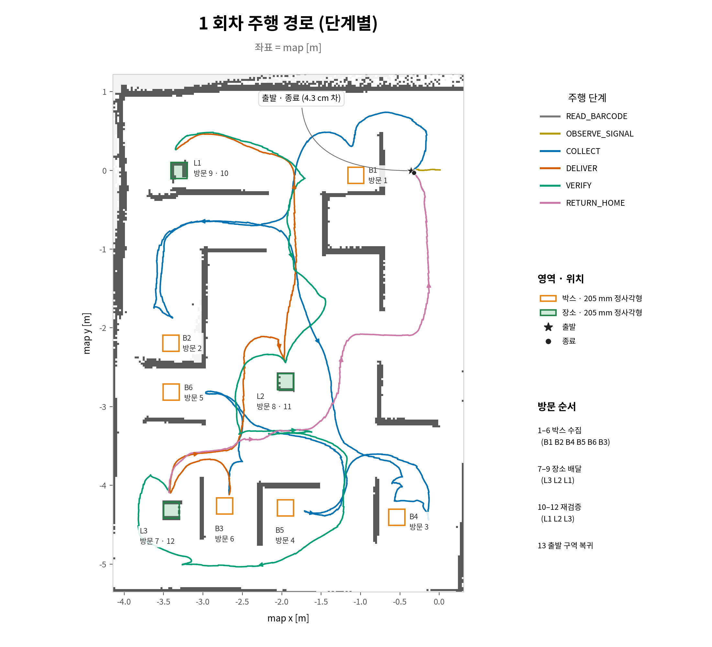

- 선 색 = 단계 (수집 · 배달 · 재검증 · 복귀), 화살표 = 진행 방향
- 주황 테두리 = 시작 박스 B1–B6, 초록 칸 = 장소 L1–L3, 라벨의 '방문 n' = 방문 순서
- 별 = 출발, 점 = 종료 (출발과 4.3 cm 차)
- 좌표 = map [m], 지도 = arena7 (회색 = 벽)

**단계 · 주행 모드 · 속도**

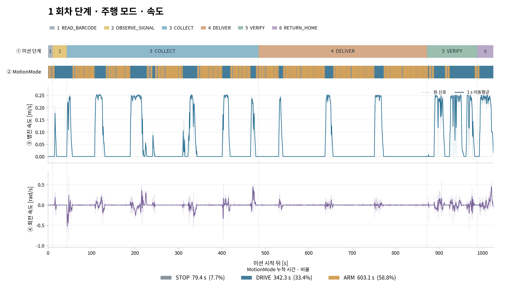

1. 미션 단계
2. MotionMode (STOP · DRIVE · ARM)
3. 병진 속도
4. 회전 속도, 세로 점선 = 단계 경계

- 속도: 옅은 선 = odom 원 신호, 진한 선 = 1 s 이동평균
- MotionMode 누적: ARM 603.1 s (58.8 %) · DRIVE 342.3 s (33.4 %) · STOP 79.4 s (7.7 %)

→ 전체 로그: [`results/logs/mission_manager.log`](results/logs/mission_manager.log)

---

### 2-3. 바코드 판독

**판독 과정**
- 벽 판을 훑는 자세 (거리 0.28 m) 에서 손목에 바코드 상자가 잡힘
- 상자가 화면 가운데에서 72 px 벗어나 다시 겨눔 (거리 0.15 m)
- 두 번째 자세에서 `P2-02` 판독
- 찾기 시작부터 판독까지 9.5 s

**판독 순간 손목 영상**

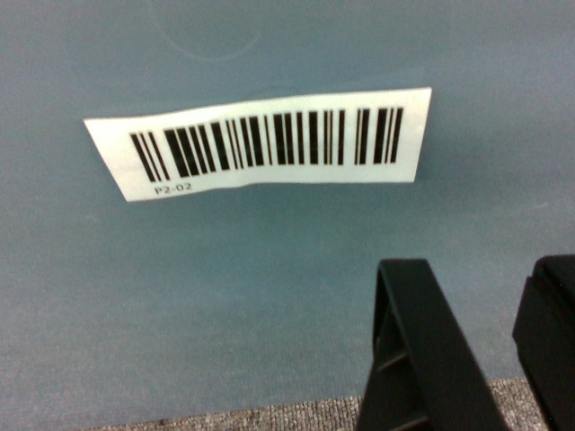

→ 판독 기록: [`results/logs/barcode_read.txt`](results/logs/barcode_read.txt)

---

### 2-4. 신호 관측

**결과**
- 12 점멸 모두 기록, 불명 0
- 점멸 길이 0.91–0.99 s
- 광각 프레임 판정 약 23 Hz, UNKNOWN 프레임은 셈에 쓰지 않음

| # | 1 | 2 | 3 | 4 | 5 | 6 | 7 | 8 | 9 | 10 | 11 | 12 |
|---|---|---|---|---|---|---|---|---|---|---|---|---|
| 색 | R | G | G | Y | Y | G | G | Y | R | R | R | Y |

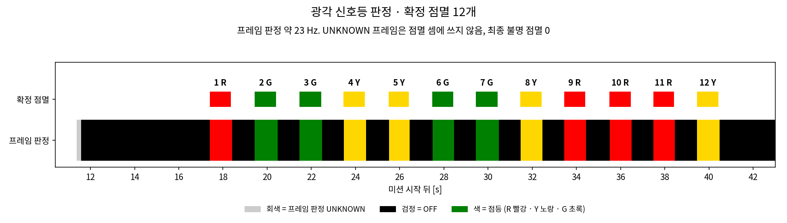

**경기 영상**

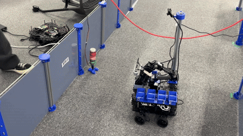

- 출발 자리에서 로봇이 선 채로 12 점멸을 봄 (왼쪽 신호등)

- `signal.json` 시각은 planning 시작 기준 (미션 시작 기준 = 그 값 − 32.19 s)

→ 전체 기록: [`results/signal.json`](results/signal.json)

---

### 2-5. 주행 · 정차

**정밀 접근 도착 오차**
- 기준: 라이다로 잰 박스 정차점
- 박스 · 장소 12 번 정차 모두 1.4 cm · 2.0° 안

| 정차 | 오차 (cm · °) | 잰 박스 ↔ 지도 (cm) |
|---|---|---|
| B1 | 0.8 · 1.7 | 9.2 |
| B2 | 0.6 · 2.0 | — |
| B4 | 1.1 · 0.6 | 5.0 |
| B5 | 1.0 · 0.7 | 5.1 |
| B6 | 1.0 · 1.7 | 14.1 |
| B3 | 1.4 · 1.1 | 12.1 |
| L3 (놓기) | 1.0 · 1.6 | 4.4 |
| L2 (놓기) | 1.2 · 1.7 | 3.3 |
| L1 (놓기) | 1.0 · 0.2 | 4.6 |
| L1 (재검증) | 1.4 · 0.5 | 보정표 사용 |
| L2 (재검증) | 1.0 · 1.4 | 3.1 |
| L3 (재검증) | 0.9 · 1.1 | 0.2 |

- 잰 박스 자리가 지도와 3–14 cm 달라도 측정으로 보정해 붙음
- B2 는 3 s 동안 범위 2 배 안에 머물러 성공 처리함

**경기 영상: L2 로 주행 → 박스 앞 정밀 접근**

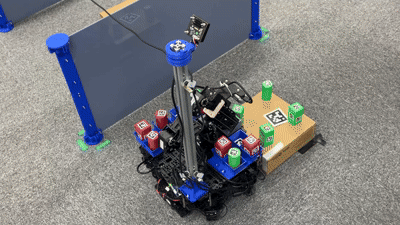

**복귀**
- 출발점 도착 오차 4.2 cm · 0.9°
- 종료 자세 ↔ 출발 중심 4.3 cm

**경기 영상: 재검증 뒤 출발 구역 복귀

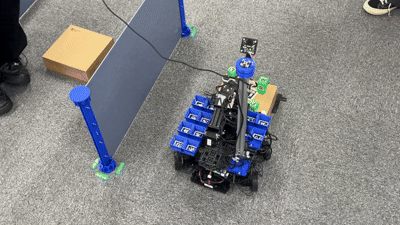

- 영상은 도착 (COMPLETED) 약 3 s 전에 끝남

→ 전체 로그: [`results/logs/navigation.log`](results/logs/navigation.log)

---

### 2-6. 팔 작업

**동작별 시간**
- 출처: `/mission/status` 단계 기록 (2 Hz, 0.5 s 단위)

| 동작 | 횟수 | 중앙 [s] | 최소–최대 [s] | 합 [s] |
|---|---|---|---|---|
| PICK | 12 | 11.3 | 6.0–32.0 | 162.5 |
| STORE | 12 | 6.5 | 5.5–10.5 | 84.5 |
| RETRIEVE | 12 | 9.8 | 9.0–13.0 | 121.5 |
| PLACE | 12 | 11.7 | 6.5–20.5 | 148.0 |
| LOOK (박스 · 장소 보기) | 20 | 4.5 | 1.0–5.0 | 73.0 |
| HOME (이동 전 접기) | 15 | 3.0 | 1.0–5.0 | 49.0 |

**결과**
- 로그상 PICK · STORE · RETRIEVE · PLACE 각 12 번 완료
- 꺼낸 뒤 손가락 사이 33.1–34.9 mm (쥠 확인)
- 이 중 적재 4 번 · 배치 1 번은 사람이 퍽을 고쳐 놓음 (2-9)
- LOOK_RACK 5 번은 control 이 일부러 건너뜀
	- 새 칸 경로로 바로 넣기 때문에 관찰이 필요 없음
	- 재고 기록대로 STORE 진행

**경기 영상**

| 수집: B2 LOOK → PICK 9 → 적재함 S3                    | 배치: 적재함 S5 RETRIEVE → L2 칸 0 PLACE                   |
| ------------------------------------------------ | ---------------------------------------------------- |
| 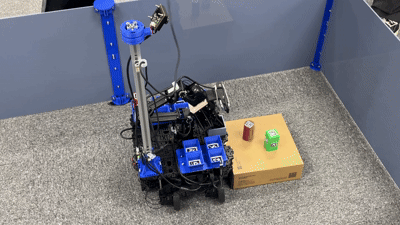 | 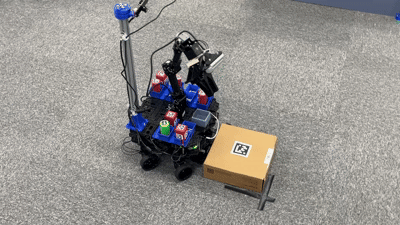 |

**적재함 12 칸 넣기 · 꺼내기**
- 출처: `/mission/status` 단계 기록, 시간 = 그 단계 시작 → 다음 단계 시작 (0.5 s 단위)

| 칸   | 퍽   | STORE 시각 [s] · 걸린 시간 [s] | RETRIEVE 시각 [s] · 걸린 시간 [s] | 결과                         |
| --- | --- | ------------------------ | --------------------------- | -------------------------- |
| S1  | 4   | 71.8 · 9.5               | 854.3 · 11.0                | 성공 (적재 뒤 사람이 퍽 세움, 2-9 #1) |
| S2  | 10  | 94.3 · 10.5              | 834.8 · 13.0                | 성공                         |
| S3  | 9   | 147.8 · 6.5              | 731.3 · 10.0                | 성공                         |
| S4  | 5   | 521.8 · 6.5              | 777.8 · 9.5                 | 성공                         |
| S5  | 6   | 457.8 · 5.5              | 661.8 · 9.5                 | 성공                         |
| S6  | 2   | 300.8 · 6.5              | 571.8 · 9.0                 | 성공 (적재 뒤 사람이 퍽 세움, 2-9 #3) |
| S7  | 7   | 391.3 · 7.0              | 715.8 · 9.0                 | 성공                         |
| S8  | 1   | 178.8 · 8.0              | 616.3 · 11.0                | 성공                         |
| S9  | 8   | 492.8 · 5.5              | 546.3 · 9.5                 | 성공                         |
| S10 | 11  | 438.3 · 6.0              | 687.3 · 9.5                 | 성공                         |
| S11 | 0   | 260.3 · 6.5              | 599.8 · 10.0                | 성공 (적재 뒤 사람이 퍽 세움, 2-9 #2) |
| S12 | 3   | 371.3 · 6.5              | 803.8 · 10.5                | 성공 (적재 뒤 사람이 퍽 세움, 2-9 #4) |

- 12 칸 모두 STORE · RETRIEVE 각 1 번, 실패 및 재시도 0
- STORE 시 4 칸은 넣은 뒤 퍽이 기울어 사람이 세움 → 넣기 동작은 닿지만 놓는 자세가 안정적이지 않음 (4 절)

**인지 처리 속도 (경기 중)**
- 손목 처리 중앙 24.3 Hz
- 분할 추론 중앙 7.9 ms

→ 전체 로그: [`results/logs/perception_rate.log`](results/logs/perception_rate.log)

---

### 2-7. 재검증

**판정 결과**

| 장소 | 그룹 | 본 퍽 (ID 색/모양) | 칸 오차 [mm] | 판정 |
|---|---|---|---|---|
| L1 | R4 | 3 R/box · 4 R/box · 5 R/box · 10 R/cyl | 2 · 11 · 9 · 7 | SUCCESS |
| L2 | Y4 | 6 G/cyl · 7 G/cyl · 9 R/cyl · 11 R/cyl | 8 · 11 · 6 · 11 | SUCCESS |
| L3 | G4 | 0 G/box · 1 G/box · 2 G/box · 8 G/cyl | 8 · 7 · 7 · 16 | SUCCESS |

- 12 개 ID 가 모두 한 번씩 보임 → 중복, 누락 0
- 칸 오차 평균 8.6 · 최대 16 mm (로봇 측정값, 자로 잰 값 아님)
- 칸 기준
	- L1 = 놓을 때 잰 박스
	- L2 · L3 = 재검증 때 다시 잰 박스
- 깊이가 틀린 프레임 (퍽 10, 7, 0, 1) 은 그 전 맞는 프레임 위치를 씀
- 로봇 몸 안 검출 9 장은 뺌

**경기 영상**

| L1 빨강 4 개 놓기 (3배속)                            | L1 재검증 LOOK                                 |
| --------------------------------------------- | ------------------------------------------- |
| 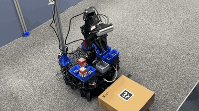 | 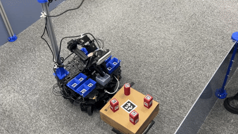 |

**재검증 영상 (로봇이 그린 원본)**

| L1 | L2 | L3 |
|---|---|---|
| 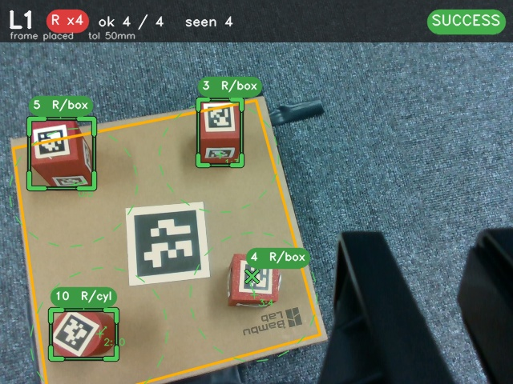 | 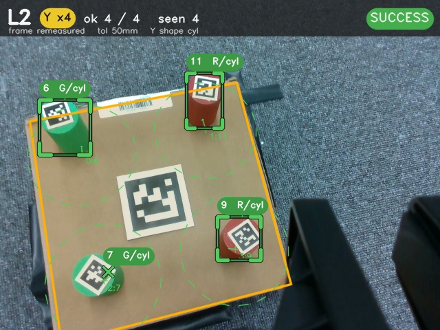 | 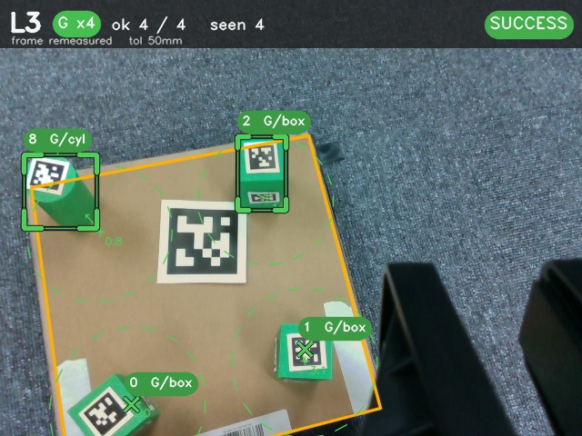 |

- 위 띠: 장소 · 그룹 · 맞은 칸 수 · 판정 (Y×4 = 같은 모양 4 개, 퍽 색 아님)
- 주황 사각형: 잰 박스 윗면
- 초록 점선 원: 칸 허용 범위 (반지름 50 mm)
- 초록 사각형: 퍽 검출 상자
- × 표시: 검출 상자 대신 판정 위치를 투영한 퍽 (L2 퍽 7 · L3 퍽 0 · 1)
- `칸:ID`: 칸 번호 : 놓은 퍽 ID
- L3 영상은 시야 아래쪽에서 박스 모서리 · 퍽 0 일부가 잘림 (판정은 3D 위치로 함)

→ 전체 기록: [`results/verify.yaml`](results/verify.yaml)

---

### 2-8. 실행 중 실패 · 자동 회복

| 시각 [s] | 실패 | 회복 |
|---|---|---|
| 218 | B4 정밀 접근 중단 (직선 경로에 박스 아닌 점) | 0.12 m 뒤에서 박스를 다시 재고 새 정차점으로 성공 |
| 322 | B5 로 가는 주행 중 PolygonStop 이 8 s 넘게 막음 | 단계 재시도 1 번 |
| 976 | 재검증 L3 로 가는 주행 시간 초과 (목표가 지도 장애물 위 → 우회 계획) | 단계 재시도 1 번 |

- <u>이동 실패 3 건은 사람 손 없이 회복</u>

**경기 영상: B4 정밀 접근 중단 → 물러나 박스 다시 재기 → 다시 붙음**


---

### 2-9. 사람 개입

| #   | 단계         | 위치                | 퍽   | 내용                       |
| --- | ---------- | ----------------- | --- | ------------------------ |
| 1   | 적재 (STORE) | B1 · 적재함 S1       | 4   | 칸에 기울어진 퍽을 손으로 세움        |
| 2   | 적재 (STORE) | B4 · 적재함 S11      | 0   | 같음                       |
| 3   | 적재 (STORE) | B4 · 적재함 S6       | 2   | 같음                       |
| 4   | 적재 (STORE) | B5 · 적재함 S12      | 3   | 같음                       |
| 5   | 배치 (PLACE) | L3 · 칸 0 (먼 줄 왼쪽) | 8   | 그리퍼에서 튕겨 나간 퍽을 손으로 칸에 놓음 |

**경기 영상**

| 1                                                | 2                                                 | 3                                                |
| ------------------------------------------------ | ------------------------------------------------- | ------------------------------------------------ |
| 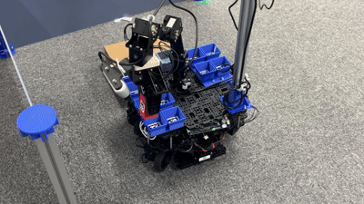 | 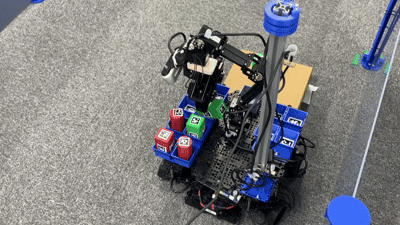 | 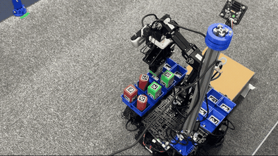 |

| 4                                                      | 5                                                        |
| ------------------------------------------------------ | -------------------------------------------------------- |
| 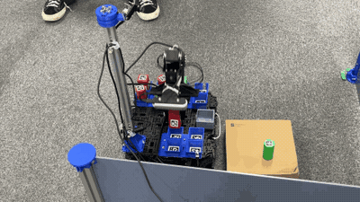 | 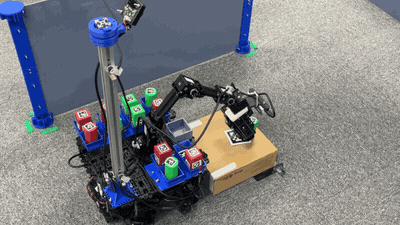 |

- 로그에는 사람 개입이 남지 않음 → 영상 구간을 로그의 같은 시각 팔 동작 (`/mission/status`) 과 맞춰 위치 · 퍽을 정함 (미션 시각 = 영상 시각 + 16.8 s)
- 적재 · 놓기 뒤 퍽이 기울어 진 경우 수정 못함 + 튕김을 스스로 고치지 못함

---

## 3. 문제점과 수정 전후

**수정 전후**

| 문제              | 수정 전                         | 수정                                       | 수정 후                               |
| --------------- | ---------------------------- | ---------------------------------------- | ---------------------------------- |
| Jetson CPU 포화   | 손목 처리 16–22 Hz, CPU 유휴 16 %  | RL · 정밀 접근 노드 C++ 로, 태그 영역 검출, 주행 중 손목 끔 | 약 25 Hz, 유휴 31 % (경기 중 중앙 24.3 Hz) |
| 지도와 실제 박스 자리 차이 | 지도 정차점에서 퍽에 팔이 안 닿음          | 라이다 박스 측정 → 정차점 보정표, 실패 시 박스 다시 재기       | 1 회차 12/12 집기, 정차 오차 1.4 cm 안      |
| 빈손 꺼내기          | 빈손도 성공 처리 → 놓으러 감            | 그리퍼 실측 → 재고 정합 → 다시 꺼냄 또는 건너뜀            | FAULT 없이 이어 감                      |
| 퍽 부족            | 끝까지 채울 장소만 놓음 (모의 test 7/12) | 부분 채우기 (부족해도 놓기로 계획된 모든 퍽 두기)            | 모의 11/12                           |
| 재검증 거짓 FAIL     | 박스 모서리 · 몸 오검출이 개수에 들어감      | 가장자리 규칙, 칸별 ID 판정, 몸 안 검출 제외             | 1 회차 세 곳 SUCCESS                   |
| perception 멈춤   | 노드 전체 멈춤 → DETECTION_LOST    | 구독 한 번만 생성, 하트비트 감시, 자동 재시작              | 재시작 뒤 켬/끔 상태 다시 맞춤                 |
| 광각 YOLO 실제 영상 성능 | 합성만 학습: 실제 test mAP50 0.597 (green_box 0.105 · traffic_light 0.523) | 합성 학습 뒤 실제 라벨 490 장으로 미세조정 | mAP50 0.949 (green_box 0.891 · traffic_light 0.993) |

---

## 4. 한계 · 향후

**시간**
- 17 분 중 팔 작업이 59 %
- PICK 최대 32 s · PLACE 최대 20.5 s → 팔 동작 절차 줄이기

**위치**
- 지도와 실제 박스 자리가 3–14 cm 달라 매번 측정으로 보정함

**적재, 놓기**
- 적재, 놓기 뒤 퍽 자세를 확인하지 않음
- 기울어지거나 튕긴 퍽을 로봇이 다시 놓지 못함

**검증**
- 배치 오차는 로봇 측정값만 있음, 자로 잰 실측 없음

---

## 5. 참고

실행 안내: [`README.md`](README.md), 개인 기여: [`docs/contributions.md`](docs/contributions.md), 시험 기록: [`results/test-results.csv`](results/test-results.csv)
